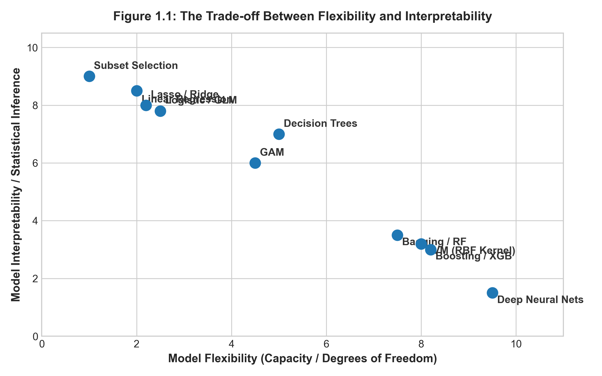

# 統計學習概論與思維典範 {#sec-ch01}

## 本章導讀

在正式進入各類繁複的演算法之前，我們必須先釐清一個根本性的問題：**何謂「統計學習」（Statistical Learning）？它與傳統統計推論、現代計算機科學主導的「機器學習」有何界限與共融之處？**

本章將從數學形式出發，嚴格定義統計學習的基本框架，剖析「預測」與「推論」的本質差異，並引入統計大師 Leo Breiman 提出的「資料科學雙文化」哲學。我們將系統展示模型彈性與可解釋性之間的權衡光譜，探討機器學習的底層公理——「歸納偏好」（Inductive Bias）與「沒有免費午餐定理」（No Free Lunch Theorem），為全書奠定嚴謹的哲學與認知基礎。

### 💡 開篇實務案例導讀：加護病房重症預警 vs 量化高頻交易定價

在當代資料驅動決策中，我們經常面臨兩類極端場景的抉擇：

1. **加護病房（ICU）敗血性休克預警**：
   重症醫學科醫師需要在病患生理指標（心率、乳酸濃度、血壓變異）異常的數小時前獲得警報。此時，醫師**絕不可能**僅憑一個黑盒子類神經網路吐出的「休克機率 89%」就草率給藥；臨床團隊必須精確獲知：「究竟是哪一項生理指標超出臨界值？其邊際效應有多大？（統計推論與可解釋性優先）」。若模型缺乏因果透明度，醫護人員的信任成本與法規醫療責任將無法承擔。
2. **避險基金微秒級高頻套利（HFT）**：
   在現代電子交易市場中，演算法在數十微秒內對買賣訂單簿（Order Book）的微小價差進行極限套利。此時交易主管毫不關心「總體經濟學利率與股價的白盒因果機制」，唯一目標是在扣除交易手續費後實現最高的預測報酬率與夏普比率（純粹預測效能優先）。

這兩個真實案例直指統計學習的核心命題：**世界上不存在「放之四海皆準的最優模型」，模型的選擇永遠取決於真實問題的「效用函數」與「責任邊界」**。

### 🎯 概念直覺與幾何啟發：真實訊號、觀測雜訊與函數投影

在展開嚴密的代數符號之前，自修者可透過以下心智模型（Mental Model）建立直覺：

* **深海礁石與表面浪花**：
  自然界生成資料的真實規律 $f(\boldsymbol{X})$，如同沉浸在海面之下的深海礁石（穩定但不可直接觀測）；我們手中取得的有限觀測樣本 $(x_i, y_i)$，則是海面上受到隨機風暴擾動的起伏浪花（疊加了不可約化雜訊 $\epsilon$）。
* **學習演算法的本質**：
  所謂「統計學習」，本質上就是「試圖僅憑海面上轉瞬即逝的有限浪花，逆向推估水底深海礁石的幾何輪廓 $\hat{f}$」。
  - **欠配適（Underfitting / 高偏誤）**：如同粗暴地將所有起伏礁石簡化為一塊平坦的水泥板（如忽視非線性效應的簡單直線）；
  - **過度配適（Overfitting / 高變異）**：如同誤把每一朵被風吹起的浪花尖端，都刻舟求劍地當成礁石的永久構造。換了一陣風（新的測試數據集），這座過度複雜的模型就會立刻崩潰。

---

## 1.1 統計學習的數學框架

在統計學習的標準設定中，我們假設觀測到一組輸入特徵（Features / Predictors / Independent Variables）向量 $\boldsymbol{X} = (X_1, X_2, \dots, X_p)^\top \in \mathbb{R}^p$，以及一個對應的目標變數（Target / Response / Dependent Variable）$Y \in \mathbb{R}$。

我們假設自然界生成資料的真實機制可以形式化表示為：
$$
Y = f(\boldsymbol{X}) + \epsilon
$$ {#eq-ch01-data-generating-process}

其中：
1. $f: \mathbb{R}^p \to \mathbb{R}$ 為未知的**真實固定函數（Fixed Unknown Function）**，它代表了系統性的規律與知識。
2. $\epsilon$ 為**隨機誤差項（Random Error Term）**，獨立於 $\boldsymbol{X}$，且滿足期望值為零，即 $\mathbb{E}[\epsilon] = 0$，變異數為 $\mathrm{Var}(\epsilon) = \sigma_\epsilon^2$。

統計學習的核心任務，就是藉由一組觀測到的訓練樣本資料集 $\mathcal{D} = \{(\boldsymbol{x}_1, y_1), (\boldsymbol{x}_2, y_2), \dots, (\boldsymbol{x}_n, y_n)\}$，透過特定的統計演算法，估計出一個未知函數 $f$ 的逼近函數，記為 $\hat{f}$。

---

## 1.2 預測、推論與誤差分解

建構估計函數 $\hat{f}$ 通常服務於兩大目標：**預測（Prediction）** 與 **統計推論（Inference）**。

### 1.2.1 可約化誤差與不可約化誤差

當我們使用 $\hat{Y} = \hat{f}(\boldsymbol{X})$ 來預測 $Y$ 時，在給定輸入 $\boldsymbol{X}$ 的條件下，預測值的均方誤差（Mean Squared Error, MSE）可以進行精確的數學分解：

$$
\begin{aligned}
\mathbb{E}\left[(Y - \hat{Y})^2 \;\middle|\; \boldsymbol{X}\right] &= \mathbb{E}\left[\left(f(\boldsymbol{X}) + \epsilon - \hat{f}(\boldsymbol{X})\right)^2 \;\middle|\; \boldsymbol{X}\right] \\
&= \mathbb{E}\left[\left((f(\boldsymbol{X}) - \hat{f}(\boldsymbol{X})) + \epsilon\right)^2 \;\middle|\; \boldsymbol{X}\right] \\
&= \mathbb{E}\left[(f(\boldsymbol{X}) - \hat{f}(\boldsymbol{X}))^2 \;\middle|\; \boldsymbol{X}\right] + 2\,\mathbb{E}\left[(f(\boldsymbol{X}) - \hat{f}(\boldsymbol{X}))\epsilon \;\middle|\; \boldsymbol{X}\right] + \mathbb{E}\left[\epsilon^2 \;\middle|\; \boldsymbol{X}\right]
\end{aligned}
$$

由於誤差項 $\epsilon$ 與 $\boldsymbol{X}$ 相互獨立，且 $\mathbb{E}[\epsilon] = 0$，中間的交叉項期望值為零：
$$
\mathbb{E}\left[(f(\boldsymbol{X}) - \hat{f}(\boldsymbol{X}))\epsilon \;\middle|\; \boldsymbol{X}\right] = (f(\boldsymbol{X}) - \hat{f}(\boldsymbol{X}))\,\mathbb{E}[\epsilon] = 0
$$

因此，上式簡化為經典的誤差分解定理：
$$
\mathbb{E}\left[(Y - \hat{Y})^2 \;\middle|\; \boldsymbol{X}\right] = \underbrace{\left[f(\boldsymbol{X}) - \hat{f}(\boldsymbol{X})\right]^2}_{\text{可約化誤差 (Reducible Error)}} + \underbrace{\sigma_\epsilon^2}_{\text{不可約化誤差 (Irreducible Error)}}
$$ {#eq-ch01-error-decomposition}

* **可約化誤差（Reducible Error）**：源於估計函數 $\hat{f}$ 與真實函數 $f$ 之間的偏離。這項誤差可透過挑選更優良的模型、採納更強的演算法、或是增加樣本量來不斷壓低。
* **不可約化誤差（Irreducible Error）**：源自隨機擾動 $\epsilon$，例如未被記錄的隱藏變數、量測儀器的固有雜訊或系統隨機性。$\sigma_\epsilon^2$ 是任何預測模型均無法突破的**理論誤差下限（Theoretical Lower Bound）**。

### 1.2.2 模型彈性與可解釋性的權衡

在機器學習與統計建模中，不存在一個在所有情境下全面勝出的「萬能模型」。模型的**彈性（Flexibility / Capacity）**與其**可解釋性（Interpretability）**往往呈現不可調和的反比關係，如 @fig-ch01-flexibility 所示：

{#fig-ch01-flexibility width=85%}

從 @fig-ch01-flexibility 可以清晰地梳理出統計學習演算法的家族光譜：
1. **高可解釋性、低彈性陣營**（如 Lasso、線性迴歸、單純貝氏）：
   * 特性：對函數形態施加了嚴格的線性或獨立性假設。
   * 優勢：參數估計具有封閉形式或高度凸性，計算開銷小，參數符號與數值具有明確的物理與經濟學意義，易於進行假設檢定與政策制定。
   * 缺點：若真實系統存在複雜非線性曲率，模型將產生嚴重的系統性欠配適（Underfitting）。
2. **中度平衡陣營**（如廣義加法模型 GAM、迴歸樣條 Splines、單一決策樹 CART）：
   * 特性：允許特徵呈現非線性平滑形態，同時保留加性結構或直觀的若-則（If-Then）規則。
3. **高彈性、低可解釋性陣營**（如隨機森林、XGBoost、支援向量機 SVM、深層神經網路）：
   * 特性：幾乎不對函數形狀作人為限制，能自由逼近任意高維非線性超曲面。
   * 優勢：預測均方誤差往往逼近理論下界，在各類預測競賽中表現極其優異。
   * 缺點：內部數百萬個參數交織成複雜黑盒子（Black-Box），極易在訓練樣本有限時捕捉偶然雜訊而過度配適（Overfitting）。

---

## 1.3 資料建模的雙文化（Two Cultures）

統計學家 Leo Breiman 於 2001 年在 *Statistical Science* 發表了劃時代的論文《Statistical Modeling: The Two Cultures》，指出分析資料的學者本質上分裂為兩大文化陣營：

```
                    ┌──────────────────────────────────────────────┐
                    │            自然界黑盒子 (Nature)             │
                    │         輸入 X ───────────► 輸出 Y           │
                    └──────────────────────┬───────────────────────┘
                                           │
                   ┌───────────────────────┴───────────────────────┐
                   ▼                                               ▼
       【第一種：資料建模文化】                        【第二種：演算法建模文化】
       (Data Modeling Culture)                     (Algorithmic Modeling Culture)
       - 代表群體：傳統統計學界                        - 代表群體：計算機科學與機器學習界
       - 核心信念：自然遵循特定的隨機分佈              - 核心信念：自然是複雜不可知的黑盒子
       - 代表模型：線性迴歸、Cox模型、GLM              - 代表模型：決策樹、SVM、神經網路
       - 核心追求：檢驗參數、估計信心區間              - 核心追求：未知測試集上的極限預測能力
```

本書的立足點是**雙文化的融合**：我們既尊重資料背後的隨機生成機制與假設檢定，也擁抱演算法對高維非線性結構的強大逼近能力。

---

## 1.4 歸納偏好與沒有免費午餐定理（NFL）

任何機器學習演算法若要具備從有限訓練樣本推廣至未知樣本的「一般化（Generalization）能力」，就必須具備某種前置假設，這種假設稱為**歸納偏好（Inductive Bias）**。例如：
* **線性迴歸**的歸納偏好是：特徵與目標之間的關係由超平面主導。
* **$K$ 最近鄰（KNN）**的歸納偏好是：在特徵空間中相鄰的樣本具有相似的輸出。

如果完全不給定任何歸納偏好，演算法的表現將受到著名的**沒有免費午餐定理（No Free Lunch Theorem, NFL）**限制。

### 沒有免費午餐定理（NFL）的精確推導

為展示學術嚴謹性，我們依據周志華（2016）的表述，給出離散設定下的 NFL 形式化證明。

假設樣本空間為 $\mathcal{X}$，標籤空間為二元分類 $\mathcal{Y} = \{0, 1\}$。真實目標函數為 $f: \mathcal{X} \to \mathcal{Y}$。假設所有可能存在的目標函數集合為 $\mathcal{F}$，其基數為 $|\mathcal{F}| = 2^{|\mathcal{X}|}$。

設有兩個相異的學習演算法 $\mathfrak{A}_a$ 與 $\mathfrak{A}_b$。給定訓練集 $\mathcal{D}$，演算法 $\mathfrak{A}_a$ 輸出的假設函數為 $h_a$。在所有可能的真實函數分佈均勻的前提下（即每個 $f$ 出現的機率均為 $1/|\mathcal{F}|$），演算法在訓練集以外之樣本空間 $\mathcal{X} \setminus \mathcal{D}$ 上的期望泛化誤差為：

$$
\mathbb{E}_f\left[E_{ote}(\mathfrak{A}_a \mid \mathcal{D})\right] = \sum_{f \in \mathcal{F}} \frac{1}{|\mathcal{F}|} \sum_{\boldsymbol{x} \in \mathcal{X} \setminus \mathcal{D}} \mathbb{I}\left(h_a(\boldsymbol{x}) \neq f(\boldsymbol{x})\right)
$$

其中 $\mathbb{I}(\cdot)$ 為指示函數。將求和順序交換：

$$
\sum_{f \in \mathcal{F}} \sum_{\boldsymbol{x} \in \mathcal{X} \setminus \mathcal{D}} \mathbb{I}\left(h_a(\boldsymbol{x}) \neq f(\boldsymbol{x})\right) = \sum_{\boldsymbol{x} \in \mathcal{X} \setminus \mathcal{D}} \sum_{f \in \mathcal{F}} \mathbb{I}\left(h_a(\boldsymbol{x}) \neq f(\boldsymbol{x})\right)
$$

對於任意固定的未見樣本點 $\boldsymbol{x} \in \mathcal{X} \setminus \mathcal{D}$，在所有可能的 $2^{|\mathcal{X}|}$ 個函數中，恰好有一半的函數使得 $f(\boldsymbol{x}) = 1$，另一半使得 $f(\boldsymbol{x}) = 0$。因此，不論演算法產生的預測值 $h_a(\boldsymbol{x})$ 究竟是 $0$ 還是 $1$，在全體可能函數中，恰好有半數與其預測相異：

$$
\sum_{f \in \mathcal{F}} \mathbb{I}\left(h_a(\boldsymbol{x}) \neq f(\boldsymbol{x})\right) = \frac{1}{2} |\mathcal{F}| = \frac{1}{2} 2^{|\mathcal{X}|}
$$

代回期望誤差式：

$$
\mathbb{E}_f\left[E_{ote}(\mathfrak{A}_a \mid \mathcal{D})\right] = \frac{1}{|\mathcal{F}|} \sum_{\boldsymbol{x} \in \mathcal{X} \setminus \mathcal{D}} \frac{1}{2}|\mathcal{F}| = \frac{1}{2} |\mathcal{X} \setminus \mathcal{D}|
$$ {#eq-ch01-nfl-result}

#### NFL 定理之重大結論：
式 ([-@eq-ch01-nfl-result]) 清楚表明，**總體期望誤差完全獨立於演算法 $\mathfrak{A}_a$ 的具體結構**！
換言之：
$$
\mathbb{E}_f\left[E_{ote}(\mathfrak{A}_a \mid \mathcal{D})\right] \equiv \mathbb{E}_f\left[E_{ote}(\mathfrak{A}_b \mid \mathcal{D})\right]
$$

> **💡 核心啟示**：脫離具體問題的先驗領域知識（Domain Knowledge），去空談「哪一種演算法最強」在數學上是毫無意義的。任何優秀演算法的優勢，必然來自其歸納偏好與特定實際問題結構的高度契合。

---

## 1.5 雙軌實務實驗室：資料生成與模型彈性探索

本節透過合成資料模擬，在 **R 語言** 與 **Python** 雙環境中對照實作資料生成、非線性趨勢擬合與過度配適的初探。

::: {.panel-tabset}
### 🟦 R 語言雙軌實作

```r
# ==============================================================================
# R 實作：統計學習初探與資料生成模擬
# 依賴套件：stats, graphics
# ==============================================================================

set.seed(42)

# 1. 定義真實函數與生成資料
n_samples <- 60
x <- runif(n_samples, min = -1, max = 1)
f_true <- function(x) sin(pi * x) + 0.5 * cos(2 * pi * x)
noise_sigma <- 0.3
y <- f_true(x) + rnorm(n_samples, mean = 0, sd = noise_sigma)

sim_data <- data.frame(x = x, y = y)

# 2. 擬合不同彈性的模型
# 模型 A: 線性迴歸 (低彈性 / 配適不足 Underfitting)
fit_linear <- lm(y ~ x, data = sim_data)

# 模型 B: 3次多項式 (適度彈性 Good Fit)
fit_poly3 <- lm(y ~ poly(x, 3, raw = TRUE), data = sim_data)

# 模型 C: 15次高階多項式 (過高彈性 / 過度配適 Overfitting)
fit_poly15 <- lm(y ~ poly(x, 15, raw = TRUE), data = sim_data)

# 3. 預測網格
x_grid <- seq(-1, 1, length.out = 300)
pred_df <- data.frame(
  x = x_grid,
  True_f = f_true(x_grid),
  Linear = predict(fit_linear, newdata = data.frame(x = x_grid)),
  Poly3 = predict(fit_poly3, newdata = data.frame(x = x_grid)),
  Poly15 = predict(fit_poly15, newdata = data.frame(x = x_grid))
)

# 4. 計算訓練樣本殘差平方和 (RSS)
rss_calc <- function(fit) sum(residuals(fit)^2)
cat(sprintf("線性迴歸 RSS: %.4f\n", rss_calc(fit_linear)))
cat(sprintf("3階多項式 RSS: %.4f\n", rss_calc(fit_poly3)))
cat(sprintf("15階多項式 RSS: %.4f\n", rss_calc(fit_poly15)))
```

### 🟨 Python 雙軌實作

```python
# ==============================================================================
# Python 實作：統計學習初探與資料生成模擬
# 依賴套件：numpy, pandas, scikit-learn
# ==============================================================================

import numpy as np
import pandas as pd
from sklearn.linear_model import LinearRegression
from sklearn.preprocessing import PolynomialFeatures
from sklearn.pipeline import make_pipeline

np.random.seed(42)

# 1. 定義真實函數與生成資料
n_samples = 60
x = np.random.uniform(-1, 1, size=n_samples)
f_true = lambda x: np.sin(np.pi * x) + 0.5 * np.cos(2 * np.pi * x)
noise_sigma = 0.3
y = f_true(x) + np.random.normal(0, noise_sigma, size=n_samples)

X_train = x[:, np.newaxis]

# 2. 擬合不同彈性的模型
# 模型 A: 線性迴歸 (低彈性)
model_linear = LinearRegression().fit(X_train, y)

# 模型 B: 3 次多項式 (適度彈性)
model_poly3 = make_pipeline(PolynomialFeatures(degree=3), LinearRegression()).fit(X_train, y)

# 模型 C: 15 次多項式 (過高彈性 / 過度配適)
model_poly15 = make_pipeline(PolynomialFeatures(degree=15), LinearRegression()).fit(X_train, y)

# 3. 計算訓練均方誤差 (Train MSE)
mse_linear = np.mean((y - model_linear.predict(X_train))**2)
mse_poly3 = np.mean((y - model_poly3.predict(X_train))**2)
mse_poly15 = np.mean((y - model_poly15.predict(X_train))**2)

print(f"線性迴歸 訓練 MSE: {mse_linear:.4f}")
print(f"3階多項式 訓練 MSE: {mse_poly3:.4f}")
print(f"15階多項式 訓練 MSE: {mse_poly15:.4f}")
```
:::

---

## 1.6 課後全方位習題庫（10 題）

### 一、觀念理解與數學證明（5 題）

1. **不可約化誤差之條件期望推導**：
   在式 ([-@eq-ch01-error-decomposition]) 的推導中，若假設隨機擾動 $\epsilon$ 的條件變異數隨特徵變更（即異變異數性 $\mathrm{Var}(\epsilon \mid \boldsymbol{X}) = \sigma^2(\boldsymbol{X})$），重新展開並推導均方誤差的期望分解式，論證不可約化誤差在特徵空間上的局部異質性。
2. **奧坎剃刀原則（Occam's Razor）之資訊論解釋**：
   統計學習理論常引述「如無必要，勿增實體」。請從最小描述長度原則（Minimum Description Length, MDL）與貝氏模型選擇的角度，論證為什麼在兩個經驗誤差相仿的模型中，結構較簡單的模型往往具備更優的泛化能力。
3. **沒有免費午餐定理的前提邊界檢討**：
   NFL 定理假設所有真實目標函數出現的機率均勻相等。試論證：若現實世界中客觀物理規律滿足「光滑性（Smoothness）」或「稀疏性（Sparsity）」先驗（即某些病態劇烈振盪的函數出現機率為零），NFL 定理是否依然成立？
4. **監督式 vs 非監督式學習的本質差異**：
   證明在非監督式學習中，不存在類似式 ([-@eq-ch01-error-decomposition]) 那樣具有唯一客觀「金標準（Ground Truth）」的泛化誤差指標。這對非監督模型的評估帶來了什麼本質上的挑戰？
5. **維度災難（Curse of Dimensionality）幾何推導**：
   設特徵空間為 $p$ 維單位超立方體 $[0, 1]^p$，樣本均勻分佈其中。欲在一個子超立方體內捕捉全體樣本的 $10\%$，計算該子超立方體的邊長 $e_p(0.1) = 0.1^{1/p}$。當維度分別為 $p=1, 2, 10, 100$ 時，數值是多少？這如何說明高維空間中「局部鄰域」概念的崩塌？

### 二、程式實作與實務應用（5 題）

6. **蒙地卡羅模擬維度災難幾何現象**：
   使用 Python 或 R 產生 $n=1000$ 筆均勻分佈在 $p$ 維超球體內的樣本點。計算隨維度 $p \in [1, 50]$ 增加時，位於超球體最外層外殼（半徑 $r \in [0.9, 1.0]$）的樣本所佔比例，驗證高維空間中「所有數據都集中在邊界」的驚人幾何特性。
7. **可解釋性與預測力對比實證**：
   在 Boston 房價或 California Housing 資料集上，分別訓練一個標準線性迴歸與一個深度為 10 的隨機森林模型。比較兩者的測試集 RMSE，並嘗試從隨機森林中直接提取特徵的單調邊際效應，記錄遭遇的黑盒子黑箱障礙。
8. **不可約化誤差邊界模擬實驗**：
   設定真實函數 $f(x) = 2x + 1$，人工疊加高斯雜訊 $\epsilon \sim \mathcal{N}(0, 2^2)$（已知 $\sigma_\epsilon^2 = 4$）。擬合由 1 階到 20 階的多項式模型，在容量為 10,000 的超大獨立測試集上計算測試 MSE，驗證測試 MSE 是否無論如何都無法突破基準線 4.0。
9. **資料生成之非線性交互作用模擬**：
   撰寫程式生成包含兩變數非線性交互項的合成資料：$y = x_1 x_2 + \sin(x_1) + \epsilon$。比較不含交互項的線性模型、包含一階交互項的線性模型以及樹狀模型的擬合殘差分佈。
10. **探索性資料分析（EDA）標準流程實現**：
    利用真實資料集（如 Auto MPG），撰寫包含特徵相關係數矩陣熱力圖、數值型變數分佈直方圖、箱型圖（Boxplot）檢測離群值以及散佈圖矩陣（Pairplot）的完整自動化 EDA 腳本。
