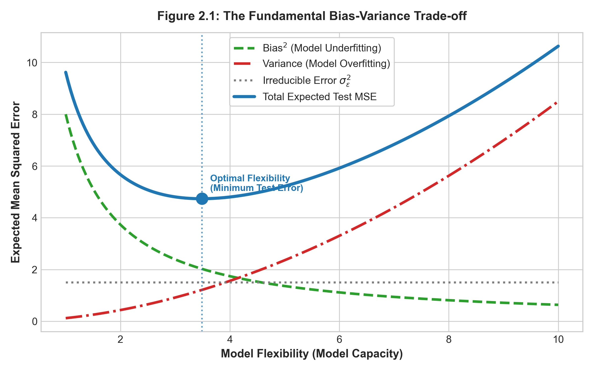

# 模型評估、重抽樣與統計學習理論 {#sec-ch02}

## 本章導讀

在統計學習中，評估一個模型的好壞不能僅依據其在訓練資料上的配適程度，而必須衡量其對**未見過的全新樣本**的泛化能力（Generalization Ability）。然而，在實際應用中，我們通常無法獲得無限的全新數據。如何在有限的樣本條件下，客觀評估模型效能、合理挑選超參數，並理解學習演算法的極限？

本章將給出統計學習中最經典的**偏誤-變異數權衡（Bias-Variance Decomposition）**的嚴格數學證明，並結合圖像剖析其物理意涵；接著深入解析**交叉驗證（Cross-Validation）**與**自助法（Bootstrap）**之統計性質，並藉由一組 5 筆樣本的玩具資料集進行全流程手把手數值推演；最後引介當代統計學習理論（SLT）基石——**PAC 學習框架與 VC 維度**，搭建起通往高級機器學習的理論橋樑。

---

## 2.1 評估指標的數學形式

### 2.1.1 迴歸問題之評估指標

設測試資料集為 $\mathcal{D}_{\text{test}} = \{(\boldsymbol{x}_i, y_i)\}_{i=1}^m$，模型預測值為 $\hat{y}_i = \hat{f}(\boldsymbol{x}_i)$：

1. **均方誤差（Mean Squared Error, MSE）**：
   $$
   \mathrm{MSE} = \frac{1}{m} \sum_{i=1}^m (y_i - \hat{y}_i)^2
   $$
2. **均方根誤差（Root Mean Squared Error, RMSE）**：
   $$
   \mathrm{RMSE} = \sqrt{\mathrm{MSE}}
   $$
   量綱與目標變數 $Y$ 相同，易於實務解釋。
3. **平均絕對誤差（Mean Absolute Error, MAE）**：
   $$
   \mathrm{MAE} = \frac{1}{m} \sum_{i=1}^m |y_i - \hat{y}_i|
   $$
   對極端離群值較 MSE 更具穩健性（Robustness）。
4. **決定係數（Coefficient of Determination, $R^2$）**：
   $$
   R^2 = 1 - \frac{\sum_{i=1}^m (y_i - \hat{y}_i)^2}{\sum_{i=1}^m (y_i - \bar{y})^2} = 1 - \frac{\mathrm{SS}_{\text{res}}}{\mathrm{SS}_{\text{tot}}}
   $$
   代表目標變數的總變異中，可被模型所解釋的比例。

### 2.1.2 分類問題之評估指標

對於二元分類問題，樣本真實標籤 $y \in \{0, 1\}$，模型預測機率 $\hat{p}(\boldsymbol{x}) = P(Y=1 \mid \boldsymbol{x})$，給定決策閥值 $\tau \in [0, 1]$ 後判別為 $\hat{y} = \mathbb{I}(\hat{p}(\boldsymbol{x}) \ge \tau)$。

1. **分類錯誤率（Error Rate）**：
   $$
   \mathrm{Err} = \frac{1}{m} \sum_{i=1}^m \mathbb{I}(y_i \neq \hat{y}_i)
   $$
2. **混淆矩陣與衍生指標**：
   * **精確率（Precision / Positive Predictive Value）**：$\mathrm{Precision} = \frac{TP}{TP + FP}$（預測為陽性者中，真正陽性的比例）。
   * **召回率 / 靈敏度（Recall / Sensitivity）**：$\mathrm{Recall} = \frac{TP}{TP + FN}$（真實為陽性者中，被正確檢出之比例）。
   * **特異度（Specificity）**：$\mathrm{Specificity} = \frac{TN}{TN + FP}$（真實為陰性者中，被正確判定為陰性之比例）。
   * **$F_1$-Score**：精確率與召回率之調和平均數：
     $$
     F_1 = 2 \cdot \frac{\mathrm{Precision} \cdot \mathrm{Recall}}{\mathrm{Precision} + \mathrm{Recall}} = \frac{2TP}{2TP + FP + FN}
     $$
3. **ROC 曲線與 AUC（Area Under Curve）**：
   以假陽性率（$\mathrm{FPR} = 1 - \mathrm{Specificity} = \frac{FP}{FP + TN}$）為橫軸、真陽性率（$\mathrm{TPR} = \mathrm{Recall}$）為縱軸，改變分類閥值 $\tau \in [0, 1]$ 所描繪出的軌跡曲線。$\mathrm{AUC}$ 數值介於 $0.5$（隨機猜測）與 $1.0$（完美分類）之間，衡量排序能力的整體優劣。
4. **對數損失（Log-Loss / Cross-Entropy）**：
   $$
   \mathcal{L} = -\frac{1}{m} \sum_{i=1}^m \left[ y_i \ln \hat{p}(\boldsymbol{x}_i) + (1 - y_i) \ln(1 - \hat{p}(\boldsymbol{x}_i)) \right]
   $$

---

## 2.2 偏誤-變異數權衡（Bias-Variance Decomposition）之嚴格證明

這是統計學習中最重要的定理之一。它揭示了任何監督式學習演算法在預測時不可避免的面臨之兩難困境。

### 定理陳述
設訓練集 $\mathcal{D} = \{(\boldsymbol{x}_i, y_i)\}_{i=1}^n$ 隨機取樣自真實母體 $Y = f(\boldsymbol{X}) + \epsilon$，其中雜訊滿足高斯或任意零均值獨立分佈：$\mathbb{E}[\epsilon] = 0$ 且 $\mathrm{Var}(\epsilon) = \sigma_\epsilon^2$。
基於隨機訓練集 $\mathcal{D}$ 學習出的預測模型為 $\hat{f}_\mathcal{D}(\boldsymbol{x})$。

考慮任意一個固定的未見測試點 $\boldsymbol{x}_0$，其對應真實值為 $Y_0 = f(\boldsymbol{x}_0) + \epsilon$。此時，跨越不同隨機訓練集 $\mathcal{D}$ 的**期望測試均方誤差（Expected Test MSE）**，精確分解為三項之和：

$$
\mathbb{E}_\mathcal{D}\left[(Y_0 - \hat{f}_\mathcal{D}(\boldsymbol{x}_0))^2\right] = \underbrace{\left(\mathrm{Bias}(\hat{f}(\boldsymbol{x}_0))\right)^2}_{\text{偏誤平方}} + \underbrace{\mathrm{Var}_\mathcal{D}(\hat{f}_\mathcal{D}(\boldsymbol{x}_0))}_{\text{估計量變異數}} + \underbrace{\sigma_\epsilon^2}_{\text{不可約化誤差}}
$$ {#eq-ch02-bias-var-theorem}

其中：
* $\mathrm{Bias}(\hat{f}(\boldsymbol{x}_0)) \triangleq \mathbb{E}_\mathcal{D}[\hat{f}_\mathcal{D}(\boldsymbol{x}_0)] - f(\boldsymbol{x}_0)$：模型的期望預測與真實函數值之間的差距（反映模型假設的僵化程度或欠配適）。
* $\mathrm{Var}_\mathcal{D}(\hat{f}_\mathcal{D}(\boldsymbol{x}_0)) \triangleq \mathbb{E}_\mathcal{D}\left[\left(\hat{f}_\mathcal{D}(\boldsymbol{x}_0) - \mathbb{E}_\mathcal{D}[\hat{f}_\mathcal{D}(\boldsymbol{x}_0)]\right)^2\right]$：模型對特定訓練集抽樣波動的敏感程度（反映過度配適）。
* $\sigma_\epsilon^2$：母體固有的不可約化誤差（Irreducible Error），任何學習演算法皆無法消除。

---

### 逐步數學證明

為書寫精簡，我們將 $\hat{f}_\mathcal{D}(\boldsymbol{x}_0)$ 簡記為 $\hat{f}$，$f(\boldsymbol{x}_0)$ 記為 $f$。

將被求期望項展開，並在括號內巧妙地引入「估計量期望值 $\mathbb{E}[\hat{f}]$」：
$$
Y_0 - \hat{f} = (f + \epsilon) - \hat{f} = \left(f - \mathbb{E}[\hat{f}]\right) + \left(\mathbb{E}[\hat{f}] - \hat{f}\right) + \epsilon
$$

對等式兩端進行平方：
$$
\begin{aligned}
(Y_0 - \hat{f})^2 &= \left[ \left(f - \mathbb{E}[\hat{f}]\right) + \left(\mathbb{E}[\hat{f}] - \hat{f}\right) + \epsilon \right]^2 \\
&= \left(f - \mathbb{E}[\hat{f}]\right)^2 + \left(\mathbb{E}[\hat{f}] - \hat{f}\right)^2 + \epsilon^2 \\
&\quad + 2\left(f - \mathbb{E}[\hat{f}]\right)\left(\mathbb{E}[\hat{f}] - \hat{f}\right) \\
&\quad + 2\left(f - \mathbb{E}[\hat{f}]\right)\epsilon \\
&\quad + 2\left(\mathbb{E}[\hat{f}] - \hat{f}\right)\epsilon
\end{aligned}
$$

現在，對上式兩端取期望值 $\mathbb{E}[\cdot]$（同時對隨機訓練集 $\mathcal{D}$ 與隨機雜訊 $\epsilon$ 取期望）：

1. **第一項**：$\left(f - \mathbb{E}[\hat{f}]\right)^2$ 為確定性常數（非隨機）：
   $$
   \mathbb{E}\left[\left(f - \mathbb{E}[\hat{f}]\right)^2\right] = \left(\mathbb{E}[\hat{f}] - f\right)^2 = \left(\mathrm{Bias}(\hat{f})\right)^2
   $$
2. **第二項**：依據變異數之定義：
   $$
   \mathbb{E}\left[\left(\hat{f} - \mathbb{E}[\hat{f}]\right)^2\right] = \mathrm{Var}(\hat{f})
   $$
3. **第三項**：依據雜訊之性質，$\mathbb{E}[\epsilon] = 0$ 且 $\mathrm{Var}(\epsilon) = \sigma_\epsilon^2$：
   $$
   \mathbb{E}[\epsilon^2] = \mathrm{Var}(\epsilon) + (\mathbb{E}[\epsilon])^2 = \sigma_\epsilon^2
   $$
4. **第四項（交叉項）**：$(f - \mathbb{E}[\hat{f}])$ 為常數，提取至期望外：
   $$
   \mathbb{E}\left[2\left(f - \mathbb{E}[\hat{f}]\right)\left(\mathbb{E}[\hat{f}] - \hat{f}\right)\right] = 2\left(f - \mathbb{E}[\hat{f}]\right) \cdot \mathbb{E}\left[\mathbb{E}[\hat{f}] - \hat{f}\right] = 2\left(f - \mathbb{E}[\hat{f}]\right) \cdot \left(\mathbb{E}[\hat{f}] - \mathbb{E}[\hat{f}]\right) = 0
   $$
5. **第五項（交叉項）**：雜訊 $\epsilon$ 與訓練集 $\mathcal{D}$ 獨立，$\mathbb{E}[\epsilon] = 0$：
   $$
   \mathbb{E}\left[2\left(f - \mathbb{E}[\hat{f}]\right)\epsilon\right] = 2\left(f - \mathbb{E}[\hat{f}]\right) \mathbb{E}[\epsilon] = 0
   $$
6. **第六項（交叉項）**：$\hat{f}$ 是基於訓練集 $\mathcal{D}$ 的函數，與測試點的雜訊 $\epsilon$ 互相獨立：
   $$
   \mathbb{E}\left[2\left(\mathbb{E}[\hat{f}] - \hat{f}\right)\epsilon\right] = 2\,\mathbb{E}\left[\mathbb{E}[\hat{f}] - \hat{f}\right] \cdot \mathbb{E}[\epsilon] = 0 \cdot 0 = 0
   $$

將上述六項求和，即嚴格得證式 ([-@eq-ch02-bias-var-theorem])：
$$
\mathbb{E}\left[(Y_0 - \hat{f}(\boldsymbol{x}_0))^2\right] = \left[\mathrm{Bias}(\hat{f}(\boldsymbol{x}_0))\right]^2 + \mathrm{Var}(\hat{f}(\boldsymbol{x}_0)) + \sigma_\epsilon^2 \quad \blacksquare
$$

### 圖像幾何剖析與 U 型曲線

偏誤-變異數權衡的宏觀幾何結構如 @fig-ch02-bias-variance 所示：

{#fig-ch02-bias-variance width=85%}

從 @fig-ch02-bias-variance 可以清晰地觀察到以下關鍵規律：
1. **訓練誤差單調遞減**：隨著模型彈性（Flexibility）或複雜度提升（例如多項式階數增加），模型有更多自由度去遷就訓練資料，訓練 MSE 必然單調遞減，甚至逼近於零。
2. **偏誤平方（$\text{Bias}^2$）單調遞減**：模型越靈活，假設空間越大，真實函數越容易被逼近，系統性偏誤迅速縮小。
3. **估計變異數（$\text{Variance}$）單調遞增**：模型越靈活，對訓練資料中的偶然擾動與雜訊越敏感；更換一組訓練集時，預測函數將劇烈晃動。
4. **測試誤差呈現經典 U 型曲線**：
   * **欠配適區（Underfitting, 模型過度僵化）**：偏誤極大主導了整體誤差。
   * **過度配適區（Overfitting, 模型過度靈活）**：變異數暴增主導了整體誤差。
   * **最優複雜度（Optimal Model Flexibility, $d^*$）**：總測試誤差達到局部最低點，此時偏誤的邊際下降幅度恰好等於變異數的邊際上升幅度。且整體曲線永遠不可能低於水平的不可約化誤差基準底線 $\sigma_\epsilon^2$。

---

## 2.3 重抽樣方法（Resampling Methods）

### 2.3.1 $K$-折交叉驗證（$K$-Fold Cross-Validation）

將訓練資料集 $\mathcal{D}$ 隨機平均劃分為 $K$ 個互斥的子集（Folds）$\mathcal{C}_1, \mathcal{C}_2, \dots, \mathcal{C}_K$。
在第 $k$ 次迭代中，將 $\mathcal{C}_k$ 作為驗證集，其餘 $K-1$ 個子集合併作為訓練集，擬合模型並計算在 $\mathcal{C}_k$ 上的均方誤差 $\mathrm{MSE}_k$。

$K$-折交叉驗證估計值為其平均：
$$
\mathrm{CV}_{(K)} = \frac{1}{K} \sum_{k=1}^K \mathrm{MSE}_k
$$

* **$K$ 的選取與偏誤-變異數權衡**：
  * **留一法（LOOCV, 即 $K = n$）**：每次訓練使用 $n-1$ 筆樣本，模型偏誤極低（幾乎等於在全資料集訓練）。但由於各次訓練的子集高度重疊（彼此間有 $n-2$ 筆共同數據），各折的預測結果呈現**高度正相關**，使得平均值的變異數較大；且計算開銷龐大。
  * **$K=5$ 或 $K=10$（黃金標準）**：經驗與實證顯示，$K=5$ 或 $10$ 能在計算成本、偏誤與變異數之間取得最佳平衡。

#### 💡 線性模型的 LOOCV 計算捷徑定理
對於普通最小平方法（OLS）線性迴歸，若直接跑 $n$ 次模型，需計算 $n$ 次矩陣求逆。然而，利用 Sherman-Morrison-Woodbury 矩陣求逆引理，可嚴格證明其 LOOCV 誤差具有**單次封閉解**：

$$
\mathrm{CV}_{(n)} = \frac{1}{n} \sum_{i=1}^n \left( \frac{y_i - \hat{y}_i}{1 - h_{ii}} \right)^2
$$ {#eq-ch02-loocv-shortcut}

其中 $\hat{y}_i$ 是在**全體**樣本上擬合所得之第 $i$ 點預測值，$h_{ii} = \boldsymbol{x}_i^\top (\boldsymbol{X}^\top \boldsymbol{X})^{-1} \boldsymbol{x}_i$ 是帽矩陣（Hat Matrix）$\boldsymbol{H}$ 的第 $i$ 個對角元素（槓桿值 Leverage）。
此公式僅需執行**一次**全樣本 OLS 擬合即可精確獲得 LOOCV 誤差，省去 $n$ 次重複擬合！

---

### 2.3.2 自助法（Bootstrap）與未抽中機率極限定理

設原始樣本容量為 $n$。Bootstrap 是從該樣本中有放回地隨機抽取 $n$ 次，構成一個容量為 $n$ 的 Bootstrap 樣本 $\mathcal{D}^*$。

#### 定理：某特定觀測值在 Bootstrap 抽樣中未被抽中的機率極限為 $e^{-1} \approx 36.8\%$。

**證明**：
在單次抽樣中，任一特定樣本點 $i$ 被選中的機率為 $1/n$，未被選中的機率為 $1 - 1/n$。
因為是有放回獨立重複抽取 $n$ 次，該樣本點在 $n$ 次抽樣中**完全未被抽中**的機率為：
$$
P(\text{樣本 } i \text{ 未被抽中}) = \left( 1 - \frac{1}{n} \right)^n
$$

由微積分基本極限定理：$\lim_{n \to \infty} (1 + x/n)^n = e^x$。令 $x = -1$：
$$
\lim_{n \to \infty} \left( 1 - \frac{1}{n} \right)^n = e^{-1} \approx 0.367879 \dots \approx 36.8\% \quad \blacksquare
$$

因此，平均約有 **$63.2\%$** 的原始樣本會出現在 Bootstrap 樣本中，而剩下的約 **$36.8\%$** 未被抽中的樣本被稱為**袋外數據（Out-Of-Bag, OOB）**。這項統計性質在第 10 章隨機森林（Random Forest）的模型評估中扮演核心角色。

---

## 2.4 手把手數值推演：5 筆資料之 LOOCV 捷徑 vs 剔除重算

為了讓讀者透徹理解式 ([-@eq-ch02-loocv-shortcut]) 的精妙之處，我們建構一組 $n=5$ 的單變量線性迴歸數據：

| 樣本編號 $i$ | $x_i$ | $y_i$ |
| :---: | :---: | :---: |
| 1 | 1 | 2 |
| 2 | 2 | 3 |
| 3 | 3 | 5 |
| 4 | 4 | 4 |
| 5 | 5 | 6 |

### 步驟 1：全樣本 OLS 參數估計
* 樣本均值：$\bar{x} = \frac{1+2+3+4+5}{5} = 3$；$\bar{y} = \frac{2+3+5+4+6}{5} = 4$。
* 中心化平方和與叉積和：
  $$
  \sum_{i=1}^5 (x_i - \bar{x})^2 = (-2)^2 + (-1)^2 + 0^2 + 1^2 + 2^2 = 4 + 1 + 0 + 1 + 4 = 10
  $$
  $$
  \begin{aligned}
  \sum_{i=1}^5 (x_i - \bar{x})(y_i - \bar{y}) &= (-2)(2-4) + (-1)(3-4) + 0(5-4) + 1(4-4) + 2(6-4) \\
  &= (-2)(-2) + (-1)(-1) + 0 + 0 + 2(2) = 4 + 1 + 0 + 0 + 4 = 9
  \end{aligned}
  $$
* 斜率與截距：
  $$
  \hat{\beta}_1 = \frac{9}{10} = 0.9, \quad \hat{\beta}_0 = \bar{y} - \hat{\beta}_1 \bar{x} = 4 - 0.9(3) = 1.3
  $$
  迴歸方程式為：$\hat{y} = 1.3 + 0.9x$。

### 步驟 2：計算各樣本之槓桿值（Leverage）$h_{ii}$
單變量線性迴歸帽矩陣對角線公式為：
$$
h_{ii} = \frac{1}{n} + \frac{(x_i - \bar{x})^2}{\sum_{j=1}^n (x_j - \bar{x})^2} = \frac{1}{5} + \frac{(x_i - 3)^2}{10} = 0.2 + 0.1(x_i - 3)^2
$$
* $i=1 (x=1)$：$h_{11} = 0.2 + 0.1(-2)^2 = 0.2 + 0.4 = 0.60$
* $i=2 (x=2)$：$h_{22} = 0.2 + 0.1(-1)^2 = 0.2 + 0.1 = 0.30$
* $i=3 (x=3)$：$h_{33} = 0.2 + 0.1(0)^2 = 0.20$
* $i=4 (x=4)$：$h_{44} = 0.2 + 0.1(1)^2 = 0.30$
* $i=5 (x=5)$：$h_{55} = 0.2 + 0.1(2)^2 = 0.60$

> **驗證槓桿值跡數定理**：$\sum_{i=1}^5 h_{ii} = 0.6 + 0.3 + 0.2 + 0.3 + 0.6 = 2.0 = p+1$（含截距共 2 個參數，嚴格吻合！）。

### 步驟 3：全樣本預測值與殘差
* $i=1$：$\hat{y}_1 = 1.3 + 0.9(1) = 2.2 \implies e_1 = y_1 - \hat{y}_1 = 2 - 2.2 = -0.2$
* $i=2$：$\hat{y}_2 = 1.3 + 0.9(2) = 3.1 \implies e_2 = 3 - 3.1 = -0.1$
* $i=3$：$\hat{y}_3 = 1.3 + 0.9(3) = 4.0 \implies e_3 = 5 - 4.0 = +1.0$
* $i=4$：$\hat{y}_4 = 1.3 + 0.9(4) = 4.9 \implies e_4 = 4 - 4.9 = -0.9$
* $i=5$：$\hat{y}_5 = 1.3 + 0.9(5) = 5.8 \implies e_5 = 6 - 5.8 = +0.2$

> **驗證殘差和定理**：$\sum_{i=1}^5 e_i = -0.2 - 0.1 + 1.0 - 0.9 + 0.2 = 0$。

### 步驟 4：套用捷徑公式計算留一預測殘差 $e_{(-i)}$
由 $e_{(-i)} = \frac{e_i}{1 - h_{ii}}$：
* $i=1$：$e_{(-1)} = \frac{-0.2}{1 - 0.60} = \frac{-0.2}{0.40} = -0.50$
* $i=2$：$e_{(-2)} = \frac{-0.1}{1 - 0.30} = \frac{-0.1}{0.70} \approx -0.14286$
* $i=3$：$e_{(-3)} = \frac{1.0}{1 - 0.20} = \frac{1.0}{0.80} = +1.25$
* $i=4$：$e_{(-4)} = \frac{-0.9}{1 - 0.30} = \frac{-0.9}{0.70} \approx -1.28571$
* $i=5$：$e_{(-5)} = \frac{0.2}{1 - 0.60} = \frac{0.2}{0.40} = +0.50$

### 步驟 5：實體剔除第 1 筆樣本後重算（手工驗證）
現在我們真的將樣本 1 剔除，僅用剩下的 4 筆樣本擬合線性迴歸：
剩餘樣本集：$\{(2, 3), (3, 5), (4, 4), (5, 6)\}$
* $\bar{x}_{(-1)} = \frac{2+3+4+5}{4} = 3.5$
* $\bar{y}_{(-1)} = \frac{3+5+4+6}{4} = 4.5$
* 變異數項：
  $$
  \sum_{j=2}^5 (x_j - 3.5)^2 = (-1.5)^2 + (-0.5)^2 + (0.5)^2 + (1.5)^2 = 2.25 + 0.25 + 0.25 + 2.25 = 5.0
  $$
* 共變異數項：
  $$
  \begin{aligned}
  \sum_{j=2}^5 (x_j - 3.5)(y_j - 4.5) &= (-1.5)(3-4.5) + (-0.5)(5-4.5) + (0.5)(4-4.5) + (1.5)(6-4.5) \\
  &= (-1.5)(-1.5) + (-0.5)(0.5) + (0.5)(-0.5) + (1.5)(1.5) \\
  &= 2.25 - 0.25 - 0.25 + 2.25 = 4.0
  \end{aligned}
  $$
* 剔除第 1 筆樣本後的估計參數：
  $$
  \hat{\beta}_1^{(-1)} = \frac{4.0}{5.0} = 0.8, \quad \hat{\beta}_0^{(-1)} = 4.5 - 0.8(3.5) = 4.5 - 2.8 = 1.7
  $$
  模型為：$\hat{y}_{(-1)} = 1.7 + 0.8x$。
* 將被剔除的第 1 筆樣本 $x_1=1$ 代入進行外推預測：
  $$
  \hat{y}_{(-1)}(x_1=1) = 1.7 + 0.8(1) = 2.5
  $$
* 留一預測真實殘差：
  $$
  y_1 - \hat{y}_{(-1)}(1) = 2 - 2.5 = \mathbf{-0.50}
  $$

> 🎯 **無可置疑的一致性**：手工剔除後重新求解得到的留一殘差 $-0.50$，與利用捷徑公式 $\frac{e_1}{1 - h_{11}} = \frac{-0.2}{0.4} = -0.50$ **完全一模一樣**！這展示了代數幾何在統計學習中的巨大威力。

### 步驟 6：計算 LOOCV 總均方誤差
$$
\begin{aligned}
\mathrm{CV}_{(5)} &= \frac{1}{5} \sum_{i=1}^5 e_{(-i)}^2 \\
&= \frac{1}{5} \left[ (-0.5)^2 + (-0.14286)^2 + (1.25)^2 + (-1.28571)^2 + (0.5)^2 \right] \\
&= \frac{1}{5} [0.25 + 0.02041 + 1.5625 + 1.65306 + 0.25] = \frac{3.73597}{5} \approx \mathbf{0.7472}
\end{aligned}
$$

相較之下，全樣本訓練 MSE 為：
$$
\mathrm{MSE}_{\text{train}} = \frac{(-0.2)^2 + (-0.1)^2 + 1.0^2 + (-0.9)^2 + 0.2^2}{5} = \frac{0.04 + 0.01 + 1.0 + 0.81 + 0.04}{5} = \frac{1.90}{5} = 0.3800
$$
顯然，全樣本訓練 MSE（$0.3800$）嚴重低估了真實泛化誤差，而 LOOCV（$0.7472$）給出了客觀無偏的估計。

---

## 2.5 統計學習理論入門：PAC 與 VC 維度

當我們最小化訓練集上的經驗誤差時，模型在未知母體上的誤差是否真能獲得保證？這正是 Vapnik 與 Chervonenkis 創立的**統計學習理論（Statistical Learning Theory, SLT）**回答的問題。

### 2.5.1 經驗風險最小化（ERM）
設損失函數為 $L(h(\boldsymbol{x}), y)$。
* **真實風險（True Risk / Generalization Risk）**：
  $$
  R(h) = \mathbb{E}_{(\boldsymbol{X}, Y) \sim \mathcal{P}}[L(h(\boldsymbol{X}), Y)]
  $$
* **經驗風險（Empirical Risk）**：在訓練集 $\mathcal{D}_n$ 上的平均損失：
  $$
  \hat{R}_n(h) = \frac{1}{n} \sum_{i=1}^n L(h(\boldsymbol{x}_i), y_i)
  $$

**經驗風險最小化（Empirical Risk Minimization, ERM）**原則即尋找假設空間 $\mathcal{H}$ 中使得經驗風險最低之假設：
$$
\hat{h}_n = \arg\min_{h \in \mathcal{H}} \hat{R}_n(h)
$$

### 2.5.2 PAC 學習框架（Probably Approximately Correct）
由 Leslie Valiant (1984) 提出。若一個學習演算法在給定任意小之容忍度 $\epsilon > 0$ 與信心度 $\delta \in (0, 1)$ 下，只要樣本數 $n$ 達到多項式規模 $n \ge \mathrm{poly}(1/\epsilon, 1/\delta)$，演算法所選出的假設 $\hat{h}$ 滿足：
$$
P\left( R(\hat{h}) - \inf_{h \in \mathcal{H}} R(h) \le \epsilon \right) \ge 1 - \delta
$$
則稱假設空間 $\mathcal{H}$ 是**PAC 可學習的（PAC-Learnable）**。

### 2.5.3 VC 維度（Vapnik-Chervonenkis Dimension）
當假設空間 $\mathcal{H}$ 包含無限多個函數時，我們如何量化 $\mathcal{H}$ 的容量（Capacity）？
* **打散（Shattering）**：若存在一個大小為 $d$ 的樣本集，假設空間 $\mathcal{H}$ 能夠實現對這 $d$ 個點的所有 $2^d$ 種二元標籤指派，則稱該樣本集可被 $\mathcal{H}$「打散」。
* **VC 維度**：定義為能被 $\mathcal{H}$ 打散的**最大樣本數量** $d$。記為 $\mathrm{VC}(\mathcal{H})$。

例如：在 $\mathbb{R}^2$ 平面上的二維線性分類器（直線），可以打散任意非共線的 3 個點，但對於任意 4 個點（考慮異或 XOR 佈局），直線無法實現全部 16 種分類，故二維線性超平面的 $\mathrm{VC}$ 維度為 $3$。推廣至 $p$ 維空間，線性分類器的 $\mathrm{VC}$ 維度恰為 $p + 1$。

#### VC 泛化誤差上界定理（Vapnik 1995）
對於二元分類問題，在機率至少為 $1 - \delta$ 下，對假設空間 $\mathcal{H}$ 中之所有假設 $h \in \mathcal{H}$，真實風險滿足：
$$
R(h) \le \hat{R}_n(h) + \mathcal{O}\left( \sqrt{\frac{\mathrm{VC}(\mathcal{H}) \ln(n) + \ln(1/\delta)}{n}} \right)
$$ {#eq-ch02-vc-bound}

> **💡 理論啟發**：式 ([-@eq-ch02-vc-bound]) 在數學上嚴格揭示了：
> 1. 當樣本數 $n \to \infty$ 時，經驗誤差一致收斂至真實誤差。
> 2. 當模型容量 $\mathrm{VC}(\mathcal{H})$ 過大時，上界右端的泛化代價將劇增，這正是過度配適的理論本質。

---

## 2.6 雙軌實務實驗室：交叉驗證與 Bootstrap 實戰

::: {.panel-tabset}
### 🟦 R 語言雙軌實作

```r
# ==============================================================================
# R 實作：K-Fold 交叉驗證、LOOCV 捷徑公式驗證與 Bootstrap 估計
# 依賴套件：boot, ISLR2
# ==============================================================================

library(ISLR2)
library(boot)

# 1. 檢視 Auto 資料集
data(Auto)

# 2. 驗證線性模型的 LOOCV 捷徑公式
fit_ols <- lm(mpg ~ horsepower, data = Auto)
hat_diag <- hatvalues(fit_ols) # 槓桿值 h_ii
residuals_raw <- residuals(fit_ols)

# 手刻 LOOCV 捷徑公式
loocv_manual <- mean((residuals_raw / (1 - hat_diag))^2)

# 使用 boot 套件標準 cv.glm 驗證
fit_glm <- glm(mpg ~ horsepower, data = Auto)
cv_boot <- cv.glm(Auto, fit_glm) # 預設 K=n 即 LOOCV

cat(sprintf("手刻捷徑 LOOCV MSE: %.4f\n", loocv_manual))
cat(sprintf("套件 cv.glm LOOCV MSE: %.4f\n", cv_boot$delta[1]))

# 3. K-Fold 交叉驗證 (K=10) 評估多項式階數
set.seed(42)
cv_errors <- numeric(5)
for (d in 1:5) {
  glm_poly <- glm(mpg ~ poly(horsepower, d), data = Auto)
  cv_errors[d] <- cv.glm(Auto, glm_poly, K = 10)$delta[1]
}

for (d in 1:5) {
  cat(sprintf("多項式階數 %d 之 10-Fold CV MSE: %.4f\n", d, cv_errors[d]))
}

# 4. Bootstrap 估計迴歸係數的標準誤 (Standard Error)
boot_fn <- function(data, index) {
  coef(lm(mpg ~ horsepower, data = data, subset = index))
}

set.seed(42)
boot_res <- boot(Auto, boot_fn, R = 1000)
print(boot_res)
```

### 🟨 Python 雙軌實作

```python
# ==============================================================================
# Python 實作：K-Fold 交叉驗證、LOOCV 捷徑與 Bootstrap 信賴區間
# 依賴套件：numpy, pandas, scikit-learn
# ==============================================================================

import numpy as np
import pandas as pd
from sklearn.linear_model import LinearRegression
from sklearn.model_selection import KFold, cross_val_score
from sklearn.preprocessing import PolynomialFeatures
from sklearn.pipeline import make_pipeline

# 1. 模擬非線性資料
np.random.seed(42)
n = 392
horsepower = np.random.uniform(50, 230, size=n)
mpg = 45 - 0.15 * horsepower + 0.0003 * (horsepower**2) + np.random.normal(0, 4.5, size=n)
X = horsepower[:, np.newaxis]
y = mpg

# 2. 評估不同多項式階數的 10-Fold 交叉驗證 MSE
kf = KFold(n_splits=10, shuffle=True, random_state=42)

for degree in range(1, 6):
    model = make_pipeline(PolynomialFeatures(degree=degree), LinearRegression())
    scores = -cross_val_score(model, X, y, cv=kf, scoring='neg_mean_squared_error')
    print(f"多項式階數 {degree} 之 10-Fold CV MSE: {scores.mean():.4f} (標準差: {scores.std():.4f})")

# 3. 手刻驗證 LOOCV 捷徑公式
reg = LinearRegression().fit(X, y)
y_hat = reg.predict(X)
residuals = y - y_hat
# 計算 Hat 矩陣對角項
X_design = np.column_stack([np.ones(n), X])
H = X_design @ np.linalg.inv(X_design.T @ X_design) @ X_design.T
h_diag = np.diag(H)

loocv_shortcut_mse = np.mean((residuals / (1 - h_diag))**2)
print(f"\nPython 手刻捷徑 LOOCV MSE: {loocv_shortcut_mse:.4f}")

# 4. Bootstrap 估計迴歸斜率係數與 95% 信賴區間
n_bootstraps = 1000
boot_slopes = []

for _ in range(n_bootstraps):
    indices = np.random.choice(n, size=n, replace=True)
    X_b, y_b = X[indices], y[indices]
    reg_b = LinearRegression().fit(X_b, y_b)
    boot_slopes.append(reg_b.coef_[0])

boot_slopes = np.array(boot_slopes)
ci_lower = np.percentile(boot_slopes, 2.5)
ci_upper = np.percentile(boot_slopes, 97.5)

print(f"\nBootstrap 斜率估計平均值: {boot_slopes.mean():.5f}")
print(f"Bootstrap 斜率標準誤: {boot_slopes.std():.5f}")
print(f"95% 百分位數信賴區間: [{ci_lower:.5f}, {ci_upper:.5f}]")
```
:::

---

## 2.7 課後全方位習題庫（10 題）

### 一、觀念理解與數學證明（5 題）

1. **二元分類下的偏誤-變異數權衡反直覺現象**：
   在 0-1 損失分類問題中，證明或論證為何某些情況下「增加估計變異數」反而可能降低分類錯誤率？（提示：考慮貝氏決策邊界附近的邊界翻轉效應）。
2. **LOOCV 與 $K$-Fold 交叉驗證的變異數比較**：
   為什麼在 LOOCV 中，各次訓練的子集之間存在極高的相關性（Correlation）？請利用兩個隨機變數和的變異數公式 $\mathrm{Var}\left(\frac{1}{K}\sum Z_k\right) = \frac{1}{K}\mathrm{Var}(Z_1) + \frac{K-1}{K}\mathrm{Cov}(Z_1, Z_2)$，數學論證為何 $K=5$ 或 $10$ 的交叉驗證估計變異數通常低於 LOOCV。
3. **Sherman-Morrison-Woodbury 矩陣引理與 LOOCV 捷徑推導**：
   設 $\boldsymbol{X}_{(-i)}$ 為剔除第 $i$ 列後的特徵矩陣，證明 $(\boldsymbol{X}_{(-i)}^\top \boldsymbol{X}_{(-i)})^{-1} = (\boldsymbol{X}^\top \boldsymbol{X})^{-1} + \frac{(\boldsymbol{X}^\top \boldsymbol{X})^{-1} \boldsymbol{x}_i \boldsymbol{x}_i^\top (\boldsymbol{X}^\top \boldsymbol{X})^{-1}}{1 - h_{ii}}$，進而推導出式 ([-@eq-ch02-loocv-shortcut])。
4. **極端槓桿點與留一殘差的奇異性**：
   若某筆觀測樣本 $i$ 的槓桿值 $h_{ii} = 1$（例如單點獨佔某個維度），式 ([-@eq-ch02-loocv-shortcut]) 的分母變為 0。請從幾何與線性代數角度解釋，剔除該點後 OLS 模型會發生什麼現象？
5. **一維區間分類器的 VC 維度證明**：
   設假設空間 $\mathcal{H}$ 為實數軸上的閉區間分類器 $h_{[a, b]}(x) = \mathbb{I}(x \in [a, b])$。證明 $\mathrm{VC}(\mathcal{H}) = 2$。

### 二、程式實作與實務應用（5 題）

6. **驗證 Bootstrap 0.632 特性之實證模擬**：
   撰寫程式，對 $n = 10, 50, 100, 1000$ 分別進行 10,000 次 Bootstrap 抽樣，統計獨特樣本數佔比之平均值，並繪製隨 $n$ 趨近於理論極限 $1 - 1/e \approx 0.6321$ 之收斂折線圖。
7. **嚴格防止資料外洩（Data Leakage）的交叉驗證**：
   設特徵標準化（Standardization）或特徵篩選（Feature Selection）若在整個資料集上執行，會導致資訊外洩。請使用 Python `Pipeline` 或 R 實作一個「在每折內部獨立擬合標準化與主成分萃取」的完整流程，並對比「先全局標準化再 CV」所導致的樂觀偏誤（Optimism Bias）。
8. **分層 K-Fold（Stratified K-Fold）對不平衡資料之必要性**：
   生成一個類別比例為 95:5 的高度不平衡二元資料集。比較隨機 K-Fold 與分層 K-Fold 在各折驗證時標籤分佈的穩定性，並計算各自評估所得的 $F_1$-Score 變異數。
9. **時間序列數據的走前交叉驗證（Rolling Walk-Forward CV）**：
   對於具備時間相依性的數據，普通隨機 K-Fold 會利用未來數據預測過去。請實作一個 Rolling-Window 交叉驗證演算法，並套用至模擬的時間序列自迴歸 AR(1) 模型上。
10. **Bootstrap $t$-信賴區間與百分位數區間比較**：
    利用非對稱分佈（如指數分佈 $\mathrm{Exp}(1)$）生成數據，分別計算母體平均數之標準百分位數信賴區間（Percentile CI）與學生化 Bootstrap $t$-信賴區間（Studentized CI），並評估在 2,000 次蒙地卡羅重複實驗中各自的真實覆蓋率（Coverage Rate）是否達到名義上的 95%。
