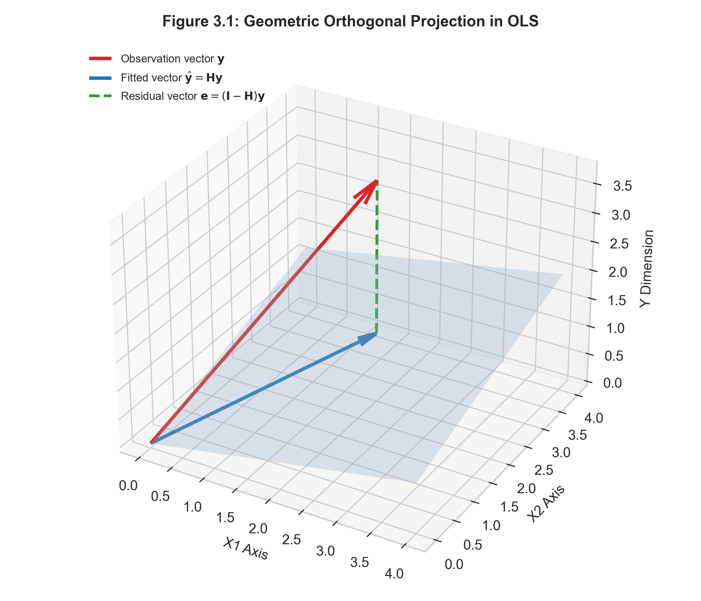

# 多元線性迴歸與古典統計推論 {#sec-ch03}

## 本章導讀

線性迴歸（Linear Regression）是整個統計學與監督式學習的基石。儘管在現代機器學習中，深層神經網路與集成演算法在複雜非線性任務上佔據主導地位，但多元線性迴歸憑藉其**極致的可解釋性（Interpretability）**、**精確的代數封閉解（Closed-form Solution）**以及完備的**小樣本統計推論（Inference）**理論，始終是任何專業資料科學家與計量學者不可或缺的核心工具。

本章將從線性代數與幾何投影出發，嚴格推導普通最小平方法（OLS）之正規方程；給出經典的 **Gauss-Markov 定理（BLUE 性質）** 之完整數學證明；藉由一個**微型數據集進行逐步手工矩陣運算演練**，徹底透視統計軟體黑盒子；深入解讀統計報表中的每一項檢定指標；最後梳理殘差診斷與多重共線性（VIF）的檢測方法，並透過 R 與 Python 進行雙軌實務比對與全套習題演練。

### 💡 開篇實務案例導讀：數位廣告跨通路投放歸因的「負數 ROI」謎團

某跨國連鎖電商在行銷季度中，同時向 Google 搜尋廣告（$X_1$）與 Meta 社交平台廣告（$X_2$）投入大筆行銷預算，以推動線上總營收（$Y$）。

單獨做一元線性迴歸時，Google 與 Meta 廣告均展現出顯著的正向營收驅動力（$p < 0.001$）。然而，當分析團隊將兩個渠道預算放進多元線性迴歸模型時，統計軟體產出卻令行銷長大驚失色：Google 廣告的邊際迴歸係數竟然變成了顯著的負數（每多投 1 萬元，模型預測總營收反而減少 3,500 元）！

為何常理下顯然有效的廣告渠道會出現「負邊際回報」？問題的癥結正是**「多元共線性（Multicollinearity）」**：
每當行銷團隊加碼 Google 預算時，總是同步加碼 Meta 廣告，導致兩個特徵向量在空間中幾乎完全平行。設計矩陣的 Gram 矩陣 $(\boldsymbol{X}^\top \boldsymbol{X})$ 因而極度接近奇異（條件數 condition number 暴增），逆矩陣在數值計算上產生劇烈震盪，將原本物理意義明確的參數估計值狠狠甩出了合理邊界。

這個案例告訴我們：不能閉著眼睛看統計報表中的 $p$ 值與係數正負，必須從底層的幾何結構與矩陣條件數徹底透視 OLS 的適用極限。

### 🎯 概念直覺與幾何啟發：正交投影、垂直影射與殘差無相關性

自修者在研讀 OLS 正規方程與帽矩陣（Hat Matrix）時，請務必在腦海中建立「光學正交投影」的幾何心智模型：

* **特徵子空間（超平面地板）**：所有預測變數向量 $\boldsymbol{x}_1, \dots, \boldsymbol{x}_p$ 的所有可能線性組合，在 $n$ 維歐式空間中張成了一個平坦的地板（列空間 $\mathcal{C}(\boldsymbol{X})$）。
* **觀測向量（懸浮在半空中的小球）**：真實的目標變數向量 $\boldsymbol{y} \in \mathbb{R}^n$ 通常無法恰好落在那張特徵地板上，而是一顆飄浮在空中的小球。
* **預測向量（垂直投射的影子）**：當我們拿一盞垂直光源由正上方照射這顆小球時，它落在特徵地板上的正交影子，就是 OLS 的最佳預測向量 $\hat{\boldsymbol{y}} = \boldsymbol{H}\boldsymbol{y}$！
* **殘差向量（垂直懸垂線）**：從小球垂直垂降到影子的直線向量 $\boldsymbol{e} = \boldsymbol{y} - \hat{\boldsymbol{y}}$，其歐氏長度正是小球到超平面地板的「最短空間直線距離」。既然是垂直正交影子，這條垂線必然與地板上的「任意一條特徵向量」都呈現精確的 90 度垂直交角（即內積嚴格為零：$\boldsymbol{X}^\top \boldsymbol{e} = \mathbf{0}$）。這正是微積分梯度歸零的深層幾何本源！

---

## 3.1 矩陣形式化與幾何投影觀點

### 3.1.1 矩陣形式設定

考慮 $n$ 個獨立樣本與 $p$ 個預測變數（包含常數截距項，總參數維度為 $p+1$）。多元線性迴歸模型以矩陣形式表示為：

$$
\boldsymbol{y} = \boldsymbol{X}\boldsymbol{\beta} + \boldsymbol{\epsilon}
$$ {#eq-ch03-matrix-model}

其中各向量與矩陣維度定義如下：
* $\boldsymbol{y} \in \mathbb{R}^n$ 為目標反應變數向量：$\boldsymbol{y} = (y_1, y_2, \dots, y_n)^\top$。
* $\boldsymbol{X} \in \mathbb{R}^{n \times (p+1)}$ 為**設計矩陣（Design Matrix）**，第一行全為 $1$ 代表截距項：
  $$
  \boldsymbol{X} = \begin{bmatrix}
  1 & x_{11} & x_{12} & \cdots & x_{1p} \\
  1 & x_{21} & x_{22} & \cdots & x_{2p} \\
  \vdots & \vdots & \vdots & \ddots & \vdots \\
  1 & x_{n1} & x_{n2} & \cdots & x_{np}
  \end{bmatrix}
  $$
* $\boldsymbol{\beta} = (\beta_0, \beta_1, \dots, \beta_p)^\top \in \mathbb{R}^{p+1}$ 為未知母體迴歸係數向量。
* $\boldsymbol{\epsilon} = (\epsilon_1, \epsilon_2, \dots, \epsilon_n)^\top \in \mathbb{R}^n$ 為隨機不可觀測之誤差向量。

#### 古典線性迴歸 Gauss-Markov 核心假設：
1. **嚴格無偏/外生性假設（Strict Exogeneity）**：$\mathbb{E}[\boldsymbol{\epsilon} \mid \boldsymbol{X}] = \boldsymbol{0}$。此假設意味著特徵變數與誤差項不相關。
2. **同變異數與無自相關（Homoscedasticity & Uncorrelated Errors）**：
   $$
   \mathrm{Cov}(\boldsymbol{\epsilon} \mid \boldsymbol{X}) = \mathbb{E}[\boldsymbol{\epsilon}\boldsymbol{\epsilon}^\top \mid \boldsymbol{X}] = \sigma^2 \boldsymbol{I}_n
   $$
   誤差項在每一個觀測點的方差恆為常數 $\sigma^2$，且不同樣本間的誤差共變異數為零。
3. **滿秩假設（Full Rank）**：$\mathrm{rank}(\boldsymbol{X}) = p+1 < n$，保證矩陣 $\boldsymbol{X}$ 的各列線性獨立，交叉矩陣 $\boldsymbol{X}^\top \boldsymbol{X}$ 為嚴格正定（Positive Definite），因而其逆矩陣保證存在。

---

### 3.1.2 最小平方法（OLS）之正規方程推導

普通最小平方法旨在尋求一組係數估計值 $\hat{\boldsymbol{\beta}}$，使得殘差平方和（Residual Sum of Squares, RSS）達到全域最小：

$$
S(\boldsymbol{\beta}) \triangleq \|\boldsymbol{y} - \boldsymbol{X}\boldsymbol{\beta}\|_2^2 = (\boldsymbol{y} - \boldsymbol{X}\boldsymbol{\beta})^\top (\boldsymbol{y} - \boldsymbol{X}\boldsymbol{\beta})
$$

展開目標函數：
$$
S(\boldsymbol{\beta}) = \boldsymbol{y}^\top \boldsymbol{y} - \boldsymbol{y}^\top \boldsymbol{X}\boldsymbol{\beta} - \boldsymbol{\beta}^\top \boldsymbol{X}^\top \boldsymbol{y} + \boldsymbol{\beta}^\top \boldsymbol{X}^\top \boldsymbol{X}\boldsymbol{\beta}
$$

注意到 $\boldsymbol{y}^\top \boldsymbol{X}\boldsymbol{\beta}$ 為 $1 \times 1$ 純量，其轉置等於自身：$(\boldsymbol{y}^\top \boldsymbol{X}\boldsymbol{\beta})^\top = \boldsymbol{\beta}^\top \boldsymbol{X}^\top \boldsymbol{y}$，因此中間兩項可合併：
$$
S(\boldsymbol{\beta}) = \boldsymbol{y}^\top \boldsymbol{y} - 2\boldsymbol{\beta}^\top \boldsymbol{X}^\top \boldsymbol{y} + \boldsymbol{\beta}^\top (\boldsymbol{X}^\top \boldsymbol{X})\boldsymbol{\beta}
$$

依據矩陣微積分法則（$\nabla_{\boldsymbol{\beta}} (\boldsymbol{a}^\top \boldsymbol{\beta}) = \boldsymbol{a}$，且對稱矩陣滿足 $\nabla_{\boldsymbol{\beta}} (\boldsymbol{\beta}^\top \boldsymbol{A}\boldsymbol{\beta}) = 2\boldsymbol{A}\boldsymbol{\beta}$）：
對 $\boldsymbol{\beta}$ 求一階梯度向量並令其為零向量：

$$
\nabla_{\boldsymbol{\beta}} S(\boldsymbol{\beta}) = -2\boldsymbol{X}^\top \boldsymbol{y} + 2(\boldsymbol{X}^\top \boldsymbol{X})\boldsymbol{\beta} = \boldsymbol{0}
$$

移項整理即得著名的**正規方程（Normal Equation）**：
$$
(\boldsymbol{X}^\top \boldsymbol{X})\hat{\boldsymbol{\beta}} = \boldsymbol{X}^\top \boldsymbol{y}
$$

由滿秩假設，$(\boldsymbol{X}^\top \boldsymbol{X})$ 可逆，解得唯一解析解：
$$
\hat{\boldsymbol{\beta}} = (\boldsymbol{X}^\top \boldsymbol{X})^{-1} \boldsymbol{X}^\top \boldsymbol{y}
$$ {#eq-ch03-ols-solution}

計算二階導數（Hessian 矩陣）：
$$
\nabla^2_{\boldsymbol{\beta}} S(\boldsymbol{\beta}) = 2\boldsymbol{X}^\top \boldsymbol{X} \succ 0
$$
Hessian 矩陣嚴格正定，證明目標函數為嚴格凸函數，式 ([-@eq-ch03-ols-solution]) 確實為全域唯一極小值點。

---

### 3.1.3 幾何正交投影觀點（Orthogonal Projection）

將 OLS 解代入預測值向量 $\hat{\boldsymbol{y}}$：
$$
\hat{\boldsymbol{y}} = \boldsymbol{X}\hat{\boldsymbol{\beta}} = \underbrace{\boldsymbol{X}(\boldsymbol{X}^\top \boldsymbol{X})^{-1}\boldsymbol{X}^\top}_{\boldsymbol{H}} \boldsymbol{y} = \boldsymbol{H}\boldsymbol{y}
$$

矩陣 $\boldsymbol{H} \in \mathbb{R}^{n \times n}$ 稱為**帽矩陣（Hat Matrix）**或**投影矩陣（Projection Matrix）**，因為它將觀測向量 $\boldsymbol{y}$「戴上帽子」變成了預測向量 $\hat{\boldsymbol{y}}$。

{#fig-ch03-ols-projection width=75%}

#### 帽矩陣 $\boldsymbol{H}$ 的代數性質：
1. **對稱性（Symmetry）**：$\boldsymbol{H}^\top = \left(\boldsymbol{X}(\boldsymbol{X}^\top \boldsymbol{X})^{-1}\boldsymbol{X}^\top\right)^\top = \boldsymbol{X}(\boldsymbol{X}^\top \boldsymbol{X})^{-1}\boldsymbol{X}^\top = \boldsymbol{H}$。
2. **冪等性（Idempotence）**：投影兩次等價於投影一次：
   $$
   \boldsymbol{H}^2 = \boldsymbol{H}\boldsymbol{H} = \boldsymbol{X}(\boldsymbol{X}^\top \boldsymbol{X})^{-1}\boldsymbol{X}^\top \boldsymbol{X}(\boldsymbol{X}^\top \boldsymbol{X})^{-1}\boldsymbol{X}^\top = \boldsymbol{X}(\boldsymbol{X}^\top \boldsymbol{X})^{-1}\boldsymbol{X}^\top = \boldsymbol{H}
   $$
3. **跡（Trace）與自由度**：
   $$
   \mathrm{tr}(\boldsymbol{H}) = \mathrm{tr}\left( \boldsymbol{X}(\boldsymbol{X}^\top \boldsymbol{X})^{-1}\boldsymbol{X}^\top \right) = \mathrm{tr}\left( (\boldsymbol{X}^\top \boldsymbol{X})^{-1}\boldsymbol{X}^\top \boldsymbol{X} \right) = \mathrm{tr}(\boldsymbol{I}_{p+1}) = p+1
   $$

#### 正交性幾何意義：
殘差向量 $\boldsymbol{e} \triangleq \boldsymbol{y} - \hat{\boldsymbol{y}} = (\boldsymbol{I}_n - \boldsymbol{H})\boldsymbol{y}$。
殘差向量與設計矩陣 $\boldsymbol{X}$ 的每一個欄位向量均嚴格正交：
$$
\boldsymbol{X}^\top \boldsymbol{e} = \boldsymbol{X}^\top (\boldsymbol{I}_n - \boldsymbol{H})\boldsymbol{y} = (\boldsymbol{X}^\top - \boldsymbol{X}^\top \boldsymbol{X}(\boldsymbol{X}^\top \boldsymbol{X})^{-1}\boldsymbol{X}^\top)\boldsymbol{y} = (\boldsymbol{X}^\top - \boldsymbol{X}^\top)\boldsymbol{y} = \boldsymbol{0}
$$
幾何上，$\hat{\boldsymbol{y}}$ 是 $n$ 維空間中向量 $\boldsymbol{y}$ 在由特徵向量所張成的 $(p+1)$ 維子空間 $\mathcal{C}(\boldsymbol{X})$ 上的**唯一正交投影**，殘差向量的長度 $\|\boldsymbol{e}\|_2$ 即為歐幾里得幾何下的最短距離。

---

## 3.2 經典微型數據：純手工矩陣逐步演算範例

為了徹底消除對統計軟體輸出的陌生感，我們透過一個極簡的 4 筆樣本數據，純手工計算出所有核心矩陣、係數、標準誤與檢定統計量。

### 3.2.1 數據設定
考慮單變量迴歸問題（含截距，故 $n=4, p=1$）：
$$
(x_1, y_1) = (1, 2), \quad (x_2, y_2) = (2, 3), \quad (x_3, y_3) = (3, 5), \quad (x_4, y_4) = (4, 4)
$$

設計矩陣 $\boldsymbol{X}$ 與反應向量 $\boldsymbol{y}$ 為：
$$
\boldsymbol{X} = \begin{bmatrix} 1 & 1 \\ 1 & 2 \\ 1 & 3 \\ 1 & 4 \end{bmatrix}, \quad \boldsymbol{y} = \begin{bmatrix} 2 \\ 3 \\ 5 \\ 4 \end{bmatrix}
$$

---

### 3.2.2 步驟 1：計算交叉乘積矩陣與逆矩陣

$$
\boldsymbol{X}^\top \boldsymbol{X} = \begin{bmatrix} 1 & 1 & 1 & 1 \\ 1 & 2 & 3 & 4 \end{bmatrix} \begin{bmatrix} 1 & 1 \\ 1 & 2 \\ 1 & 3 \\ 1 & 4 \end{bmatrix} = \begin{bmatrix} 4 & 10 \\ 10 & 30 \end{bmatrix}
$$

計算行列式：
$$
\det(\boldsymbol{X}^\top \boldsymbol{X}) = (4)(30) - (10)(10) = 120 - 100 = 20
$$

利用二階伴隨矩陣公式求解逆矩陣：
$$
(\boldsymbol{X}^\top \boldsymbol{X})^{-1} = \frac{1}{20} \begin{bmatrix} 30 & -10 \\ -10 & 4 \end{bmatrix} = \begin{bmatrix} 1.5 & -0.5 \\ -0.5 & 0.2 \end{bmatrix}
$$

---

### 3.2.3 步驟 2：計算 $\boldsymbol{X}^\top \boldsymbol{y}$ 與係數估計量 $\hat{\boldsymbol{\beta}}$

$$
\boldsymbol{X}^\top \boldsymbol{y} = \begin{bmatrix} 1 & 1 & 1 & 1 \\ 1 & 2 & 3 & 4 \end{bmatrix} \begin{bmatrix} 2 \\ 3 \\ 5 \\ 4 \end{bmatrix} = \begin{bmatrix} 2 + 3 + 5 + 4 \\ 2(1) + 3(2) + 5(3) + 4(4) \end{bmatrix} = \begin{bmatrix} 14 \\ 39 \end{bmatrix}
$$

計算 OLS 估計值：
$$
\hat{\boldsymbol{\beta}} = (\boldsymbol{X}^\top \boldsymbol{X})^{-1} \boldsymbol{X}^\top \boldsymbol{y} = \begin{bmatrix} 1.5 & -0.5 \\ -0.5 & 0.2 \end{bmatrix} \begin{bmatrix} 14 \\ 39 \end{bmatrix} = \begin{bmatrix} 1.5(14) - 0.5(39) \\ -0.5(14) + 0.2(39) \end{bmatrix} = \begin{bmatrix} 21 - 19.5 \\ -7 + 7.8 \end{bmatrix} = \begin{bmatrix} 1.5 \\ 0.8 \end{bmatrix}
$$
解得截距項 $\hat{\beta}_0 = 1.5$，斜率項 $\hat{\beta}_1 = 0.8$。擬合直線為：$\hat{y} = 1.5 + 0.8 x$。

---

### 3.2.4 步驟 3：計算殘差、$\mathrm{RSS}$ 與誤差變異數 $s^2$

| 樣本 $i$ | $x_i$ | $y_i$ | 擬合值 $\hat{y}_i = 1.5 + 0.8x_i$ | 殘差 $e_i = y_i - \hat{y}_i$ | 殘差平方 $e_i^2$ |
| :---: | :---: | :---: | :---: | :---: | :---: |
| 1 | 1 | 2 | $1.5 + 0.8(1) = 2.3$ | $2 - 2.3 = -0.3$ | 0.09 |
| 2 | 2 | 3 | $1.5 + 0.8(2) = 3.1$ | $3 - 3.1 = -0.1$ | 0.01 |
| 3 | 3 | 5 | $1.5 + 0.8(3) = 3.9$ | $5 - 3.9 = +1.1$ | 1.21 |
| 4 | 4 | 4 | $1.5 + 0.8(4) = 4.7$ | $4 - 4.7 = -0.7$ | 0.49 |
| **總和**| 10 | 14 | 14.0 | **0.0** | $\mathbf{\mathrm{RSS} = 1.80}$ |

* 殘差和驗證：$\sum e_i = -0.3 - 0.1 + 1.1 - 0.7 = 0$（嚴格歸零）。
* 殘差自由度：$df = n - (p+1) = 4 - 2 = 2$。
* 誤差變異數不偏估計量：
  $$
  s^2 = \hat{\sigma}^2 = \frac{\mathrm{RSS}}{n - p - 1} = \frac{1.80}{2} = 0.90 \implies s = \sqrt{0.90} \approx 0.9487
  $$

---

### 3.2.5 步驟 4：計算參數標準誤與 $t$ 檢定統計量

共變異數矩陣估計式：
$$
\widehat{\mathrm{Cov}}(\hat{\boldsymbol{\beta}}) = s^2 (\boldsymbol{X}^\top \boldsymbol{X})^{-1} = 0.90 \begin{bmatrix} 1.5 & -0.5 \\ -0.5 & 0.2 \end{bmatrix} = \begin{bmatrix} 1.35 & -0.45 \\ -0.45 & 0.18 \end{bmatrix}
$$

* 截距項標準誤：$\mathrm{SE}(\hat{\beta}_0) = \sqrt{1.35} \approx 1.1619$。
* 斜率項標準誤：$\mathrm{SE}(\hat{\beta}_1) = \sqrt{0.18} \approx 0.4243$。

計算檢驗 $H_0: \beta_1 = 0$ 的 $t$ 統計量：
$$
t = \frac{\hat{\beta}_1 - 0}{\mathrm{SE}(\hat{\beta}_1)} = \frac{0.8}{0.4243} \approx 1.8856
$$

在自由度 $df=2$ 下，$t = 1.8856$ 對應的雙尾 $p$-值約為 $0.20$。因為樣本數極小（$n=4$），在 $\alpha = 0.05$ 下不具備足夠統計檢定力拒絕虛無假設。

---

### 3.2.6 步驟 5：決定係數 $R^2$ 手算

目標變數平均值 $\bar{y} = 14 / 4 = 3.5$。
總平方和（TSS）：
$$
\mathrm{TSS} = \sum (y_i - \bar{y})^2 = (2-3.5)^2 + (3-3.5)^2 + (5-3.5)^2 + (4-3.5)^2 = 2.25 + 0.25 + 2.25 + 0.25 = 5.0
$$

決定係數：
$$
R^2 = 1 - \frac{\mathrm{RSS}}{\mathrm{TSS}} = 1 - \frac{1.80}{5.0} = 1 - 0.36 = 0.64
$$
代表自變數 $x$ 解釋了目標變數 $y$ 約 $64\%$ 的變異。

---

## 3.3 Gauss-Markov 定理（BLUE 性質）之嚴格證明

Gauss-Markov 定理奠定了 OLS 的經典理論地位：在所有線性不偏估計量中，OLS 的變異數最小。

### 定理陳述
在 Gauss-Markov 假設下，$\hat{\boldsymbol{\beta}} = (\boldsymbol{X}^\top \boldsymbol{X})^{-1}\boldsymbol{X}^\top \boldsymbol{y}$ 是母體參數 $\boldsymbol{\beta}$ 的**最佳線性不偏估計量（Best Linear Unbiased Estimator, BLUE）**。
對任意競爭的線性不偏估計量 $\tilde{\boldsymbol{\beta}}$，矩陣差額 $\mathrm{Cov}(\tilde{\boldsymbol{\beta}}) - \mathrm{Cov}(\hat{\boldsymbol{\beta}})$ 為半正定矩陣：
$$
\mathrm{Cov}(\tilde{\boldsymbol{\beta}}) \succeq \mathrm{Cov}(\hat{\boldsymbol{\beta}})
$$

### 證明過程

1. **OLS 的共變異數矩陣**：
   $$
   \begin{aligned}
   \mathrm{Cov}(\hat{\boldsymbol{\beta}} \mid \boldsymbol{X}) &= \mathrm{Cov}\left((\boldsymbol{X}^\top \boldsymbol{X})^{-1}\boldsymbol{X}^\top \boldsymbol{y} \;\middle|\; \boldsymbol{X}\right) \\
   &= (\boldsymbol{X}^\top \boldsymbol{X})^{-1}\boldsymbol{X}^\top \mathrm{Cov}(\boldsymbol{y} \mid \boldsymbol{X}) \boldsymbol{X}(\boldsymbol{X}^\top \boldsymbol{X})^{-1} \\
   &= (\boldsymbol{X}^\top \boldsymbol{X})^{-1}\boldsymbol{X}^\top (\sigma^2 \boldsymbol{I}_n) \boldsymbol{X}(\boldsymbol{X}^\top \boldsymbol{X})^{-1} = \sigma^2 (\boldsymbol{X}^\top \boldsymbol{X})^{-1}
   \end{aligned}
   $$

2. **構造任意競爭線性估計量**：
   設 $\tilde{\boldsymbol{\beta}} = \boldsymbol{C}\boldsymbol{y}$。令 $\boldsymbol{C} = (\boldsymbol{X}^\top \boldsymbol{X})^{-1}\boldsymbol{X}^\top + \boldsymbol{D}$，其中 $\boldsymbol{D} \in \mathbb{R}^{(p+1) \times n}$。
   施加不偏性約束：
   $$
   \mathbb{E}[\tilde{\boldsymbol{\beta}} \mid \boldsymbol{X}] = \boldsymbol{C}\boldsymbol{X}\boldsymbol{\beta} = \left[(\boldsymbol{X}^\top \boldsymbol{X})^{-1}\boldsymbol{X}^\top \boldsymbol{X} + \boldsymbol{D}\boldsymbol{X}\right]\boldsymbol{\beta} = (\boldsymbol{I}_{p+1} + \boldsymbol{D}\boldsymbol{X})\boldsymbol{\beta} \equiv \boldsymbol{\beta}
   $$
   為了對任意 $\boldsymbol{\beta}$ 皆成立，充要條件為：
   $$
   \boldsymbol{D}\boldsymbol{X} = \boldsymbol{0} \iff \boldsymbol{X}^\top \boldsymbol{D}^\top = \boldsymbol{0}
   $$

3. **計算共變異數矩陣並消去交叉項**：
   $$
   \begin{aligned}
   \mathrm{Cov}(\tilde{\boldsymbol{\beta}} \mid \boldsymbol{X}) &= \sigma^2 \boldsymbol{C}\boldsymbol{C}^\top = \sigma^2 \left[(\boldsymbol{X}^\top \boldsymbol{X})^{-1}\boldsymbol{X}^\top + \boldsymbol{D}\right] \left[\boldsymbol{X}(\boldsymbol{X}^\top \boldsymbol{X})^{-1} + \boldsymbol{D}^\top\right] \\
   &= \sigma^2 \left[ (\boldsymbol{X}^\top \boldsymbol{X})^{-1}\boldsymbol{X}^\top \boldsymbol{X}(\boldsymbol{X}^\top \boldsymbol{X})^{-1} + \boldsymbol{D}\boldsymbol{X}(\boldsymbol{X}^\top \boldsymbol{X})^{-1} + (\boldsymbol{X}^\top \boldsymbol{X})^{-1}\boldsymbol{X}^\top \boldsymbol{D}^\top + \boldsymbol{D}\boldsymbol{D}^\top \right] \\
   &= \sigma^2 (\boldsymbol{X}^\top \boldsymbol{X})^{-1} + \sigma^2 \boldsymbol{D}\boldsymbol{D}^\top = \mathrm{Cov}(\hat{\boldsymbol{\beta}} \mid \boldsymbol{X}) + \sigma^2 \boldsymbol{D}\boldsymbol{D}^\top
   \end{aligned}
   $$

4. **半正定性確立**：
   對任意非零向量 $\boldsymbol{a} \in \mathbb{R}^{p+1}$：
   $$
   \boldsymbol{a}^\top \left[ \mathrm{Cov}(\tilde{\boldsymbol{\beta}}) - \mathrm{Cov}(\hat{\boldsymbol{\beta}}) \right] \boldsymbol{a} = \sigma^2 \boldsymbol{a}^\top (\boldsymbol{D}\boldsymbol{D}^\top) \boldsymbol{a} = \sigma^2 \|\boldsymbol{D}^\top \boldsymbol{a}\|_2^2 \ge 0
   $$
   等號成立若且唯若 $\boldsymbol{D}^\top \boldsymbol{a} = \boldsymbol{0}, \forall \boldsymbol{a} \iff \boldsymbol{D} = \boldsymbol{0}$。
   得證 OLS 是方差最小的最佳線性不偏估計量 $\quad \blacksquare$

---

## 3.4 真實資料案例：統計報表逐行深度解讀

在真實數據分析中，軟體輸出的統計摘要報表包含大量核心資訊。以下以 Boston 房價資料集的真實模型輸出為例，進行教學級的**逐行逐欄剖析**：

```
Coefficients:
            Estimate Std. Error t value Pr(>|t|)    
(Intercept) 32.82804    2.46644  13.310  < 2e-16 ***
lstat       -0.56308    0.04797 -11.737  < 2e-16 ***
rm           4.51518    0.42589  10.602  < 2e-16 ***
crim        -0.17983    0.03541  -5.078 5.48e-07 ***
---
Residual standard error: 5.474 on 502 degrees of freedom
Multiple R-squared:  0.6459,	Adjusted R-squared:  0.6438 
F-statistic: 305.2 on 3 and 502 DF,  p-value: < 2.2e-16
```

### 報表各指標深度拆解手冊：
1. **`Estimate`（點估計值 $\hat{\beta}_j$）**：
   * `lstat = -0.56308`：在固定其他變數（房間數 `rm` 與犯罪率 `crim`）不變的條件下，低收入人口比例每增加 1 個百分點，房屋中位價**期望下降約 0.563 單位（約 563 美元）**。
   * `rm = 4.51518`：在控制其他條件下，住宅平均房間數每增加 1 間，房價期望上升約 4,515 美元。
2. **`Std. Error`（標準誤 $\mathrm{SE}(\hat{\beta}_j)$）**：
   * 衡量若從相同母體中反覆抽樣訓練模型，該係數估計值的抽樣波動度。計算式為 $s \sqrt{[(\boldsymbol{X}^\top \boldsymbol{X})^{-1}]_{jj}}$。
3. **`t value`（$t$ 統計量）**：
   * $t = \frac{\text{Estimate} - 0}{\text{Std. Error}}$。例如 `crim`: $-0.17983 / 0.03541 = -5.078$。它衡量估計值距離虛無假設 0 有幾個標準誤之遙。
4. **`Pr(>|t|)`（$p$-值）**：
   * 在虛無假設為真（即犯罪率對房價毫無影響）的前提下，純粹因為隨機抽樣誤差而觀測到 $t$ 絕對值大於等於 $5.078$ 的極端機率。此處為 $5.48 \times 10^{-7}$，遠小於常規閥值 $0.05$，故具有極高統計顯著性。
5. **`Residual standard error`（殘差標準誤 $s$）**：
   * $s = 5.474$，自由度為 $506 - 4 = 502$。代表模型預測房價的平均典型誤差約為 5,474 美元。
6. **`Multiple R-squared` vs `Adjusted R-squared`**：
   * $R^2 = 0.6459$：模型解釋了房價 $64.59\%$ 的變異。
   * **調整後決定係數（Adjusted $R^2$）**：
     $$
     R_{\text{adj}}^2 \triangleq 1 - \frac{\mathrm{RSS} / (n - p - 1)}{\mathrm{TSS} / (n - 1)} = 1 - (1 - R^2)\frac{n - 1}{n - p - 1}
     $$
     **注意**：普通 $R^2$ 隨著特徵數 $p$ 增加**單調不減**（即使加入純隨機雜訊變數，$R^2$ 也會微幅上升）。調整後 $R_{\text{adj}}^2$ 引入了自由度懲罰，只有當新特徵帶來的變異解釋能力超過隨機期望時，數值才會上升。
7. **`F-statistic`（整體模型 $F$ 檢定）**：
   * 檢定虛無假設 $H_0: \beta_{\text{lstat}} = \beta_{\text{rm}} = \beta_{\text{crim}} = 0$。$F = 305.2$，$p < 2.2 \times 10^{-16}$，拒絕虛無假設，證明三個特徵聯合起來對房價具有強大解釋力。

---

## 3.5 模型診斷與多重共線性檢測

### 3.5.1 四大標準殘差診斷圖
1. **殘差 vs 擬合值圖（Residuals vs Fitted）**：
   檢驗**線性假設**與**同變異數性（Homoscedasticity）**。理想狀態下，點應均勻散佈在一條以 0 為中心的水平帶狀區域內。若呈現漏斗型（Funnel），表明存在異變異數，應考慮對目標變數進行對數轉換 $\ln(Y)$ 或 Box-Cox 轉換。
2. **常態 Q-Q 圖（Normal Q-Q）**：
   檢驗**誤差常態性**。點應落在 $45^\circ$ 對角參考線上。兩端若上翹或下垂，表明殘差分佈存在厚尾或偏態。
3. **槓桿值（Leverage $h_{ii}$）**：
   帽矩陣對角項 $h_{ii} = \boldsymbol{x}_i^\top (\boldsymbol{X}^\top \boldsymbol{X})^{-1} \boldsymbol{x}_i$。其物理意義為樣本點 $\boldsymbol{x}_i$ 在特徵空間中距離重心的遠近。平均槓桿值為 $(p+1)/n$。若 $h_{ii} > 3(p+1)/n$，視為極端高槓桿點。
4. **庫克距離（Cook's Distance）**：
   $$
   D_i = \frac{e_i^2}{(p+1)s^2} \left( \frac{h_{ii}}{(1 - h_{ii})^2} \right)
   $$
   綜合考量殘差大小與槓桿值。當 $D_i > 4/n$ 時，表示該單一樣本點對回歸係數估計造成了不成比例的巨大牽引。

### 3.5.2 變異數膨脹因子（VIF）
當兩個或多個特徵高度線性相關時，$(\boldsymbol{X}^\top \boldsymbol{X})$ 的行列式趨近於零，係數估計的標準誤將劇烈膨脹。

特徵 $X_j$ 的**變異數膨脹因子（Variance Inflation Factor, VIF）**為：
$$
\mathrm{VIF}_j \triangleq \frac{1}{1 - R_j^2}
$$
其中 $R_j^2$ 為特徵 $X_j$ 對其餘 $p-1$ 個特徵進行輔助迴歸所得的決定係數。
* $\mathrm{VIF} = 1$：完全不相關。
* $\mathrm{VIF} > 5$：中度共線性。
* $\mathrm{VIF} > 10$：嚴重多重共線性，必須透過特徵剔除或正則化（第 4 章）進行處理。

---

## 3.6 雙軌實務實驗室：多元線性迴歸報表與診斷

::: {.panel-tabset}
### 🟦 R 語言雙軌實作

```r
# ==============================================================================
# R 實作：多元線性迴歸、模型診斷與多重共線性檢驗 (VIF)
# 依賴套件：car, ISLR2
# ==============================================================================

library(ISLR2)
library(car)

# 1. 載入波士頓房價資料集 (Boston)
data(Boston)

# 2. 建立多元線性迴歸模型：以 medv (房價中位數) 為目標
fit_boston <- lm(medv ~ lstat + rm + crim + nox + dis + ptratio, data = Boston)

# 3. 輸出詳細統計檢定報表
summary(fit_boston)

# 4. 多重共線性檢驗：計算 VIF
vif_values <- car::vif(fit_boston)
cat("\n各特徵之變異數膨脹因子 (VIF):\n")
print(round(vif_values, 3))

# 5. 計算殘差與影響力指標
boston_diag <- data.frame(
  fitted = fitted(fit_boston),
  residuals = residuals(fit_boston),
  std_resid = rstandard(fit_boston),
  leverage = hatvalues(fit_boston),
  cooks_d = cooks.distance(fit_boston)
)

# 篩選高槓桿點與高影響力點
p_plus_1 <- length(coef(fit_boston))
n <- nrow(Boston)
high_leverage_cutoff <- 2 * p_plus_1 / n

cat(sprintf("\n高槓桿點門檻 (2*(p+1)/n): %.4f\n", high_leverage_cutoff))
cat(sprintf("高槓桿樣本數量: %d / %d\n", sum(boston_diag$leverage > high_leverage_cutoff), n))
cat(sprintf("Cook's D > 4/n 之影響力樣本數量: %d\n", sum(boston_diag$cooks_d > (4 / n))))
```

### 🟨 Python 雙軌實作

```python
# ==============================================================================
# Python 實作：statsmodels 多元線性迴歸報表與 VIF 檢測
# 依賴套件：numpy, pandas, statsmodels, sklearn
# ==============================================================================

import numpy as np
import pandas as pd
import statsmodels.api as sm
from statsmodels.stats.outliers_influence import variance_inflation_factor

# 1. 模擬具備多重共線性的資料集
np.random.seed(42)
n = 300

# x1 與 x2 具有極高的相關性 (共線性)
x1 = np.random.normal(10, 2, n)
x2 = 0.9 * x1 + np.random.normal(0, 0.5, n)
x3 = np.random.normal(5, 1, n)

# y 的真實生成過程
y = 3.5 + 2.0 * x1 + 0.5 * x2 - 1.2 * x3 + np.random.normal(0, 1.5, n)

df = pd.DataFrame({'x1': x1, 'x2': x2, 'x3': x3})

# 2. 加入截距項並擬合 OLS 模型
X = sm.add_constant(df)
ols_model = sm.OLS(y, X).fit()

# 3. 輸出詳細統計檢定摘要 (含 t檢定, F檢定, R-squared)
print(ols_model.summary())

# 4. 計算變異數膨脹因子 (VIF)
vif_data = pd.DataFrame()
vif_data["Feature"] = X.columns
vif_data["VIF"] = [variance_inflation_factor(X.values, i) for i in range(X.shape[1])]

print("\n變異數膨脹因子 (VIF) 檢測結果:")
print(vif_data.to_string(index=False))

# 5. 計算殘差診斷指標
influence = ols_model.get_influence()
leverage = influence.hat_matrix_diag
cooks_d = influence.cooks_distance[0]

p_plus_1 = X.shape[1]
high_lev_threshold = 2 * p_plus_1 / n
print(f"\n高槓桿點門檻 (2*(p+1)/n): {high_lev_threshold:.4f}")
print(f"檢測出高槓桿樣本數量: {np.sum(leverage > high_lev_threshold)} / {n}")
```
:::

---

## 3.7 本章全套習題庫（Exercises）

### 第一部分：觀念與數學推導題（Conceptual Exercises）

1. **帽矩陣的代數性質證明**：
   設設計矩陣 $\boldsymbol{X} \in \mathbb{R}^{n \times (p+1)}$ 具備滿行秩。
   * 請嚴格證明：$\boldsymbol{H}$ 為對稱矩陣且為冪等矩陣（$\boldsymbol{H}^2 = \boldsymbol{H}$）。
   * 請證明殘差投影矩陣 $\boldsymbol{M} = \boldsymbol{I}_n - \boldsymbol{H}$ 亦為對稱且冪等矩陣。
   * 請證明全體槓桿值的總和恰好等於模型參數個數：$\sum_{i=1}^n h_{ii} = p + 1$。
2. **中心化矩陣與 OLS 截距項**：
   定義中心化矩陣 $\boldsymbol{C} = \boldsymbol{I}_n - \frac{1}{n}\boldsymbol{1}\boldsymbol{1}^\top$。
   * 請證明對任意向量 $\boldsymbol{v}$，$\boldsymbol{C}\boldsymbol{v}$ 的元素均值必為 0。
   * 試利用中心化矩陣證明：多元線性迴歸中的斜率估計量 $\hat{\boldsymbol{\beta}}_{1:p}$，等價於先將 $\boldsymbol{y}$ 與特徵矩陣各自中心化後、在無截距項下所求得之 OLS 解。
3. **Frisch-Waugh-Lovell (FWL) 定理推導**：
   設模型為 $\boldsymbol{y} = \boldsymbol{X}_1 \boldsymbol{\beta}_1 + \boldsymbol{X}_2 \boldsymbol{\beta}_2 + \boldsymbol{\epsilon}$。
   * 請證明：$\boldsymbol{\beta}_2$ 的 OLS 估計量，精確等價於以下兩步驟：
     1. 將 $\boldsymbol{y}$ 對 $\boldsymbol{X}_1$ 迴歸取得殘差 $\boldsymbol{e}_{\boldsymbol{y}|\boldsymbol{X}_1}$。
     2. 將 $\boldsymbol{X}_2$ 的每一個特徵分別對 $\boldsymbol{X}_1$ 迴歸取得殘差矩陣 $\boldsymbol{E}_{\boldsymbol{X}_2|\boldsymbol{X}_1}$。
     3. 將 $\boldsymbol{e}_{\boldsymbol{y}|\boldsymbol{X}_1}$ 對 $\boldsymbol{E}_{\boldsymbol{X}_2|\boldsymbol{X}_1}$ 進行無截距 OLS 迴歸。
   * 請說明該定理如何詮釋了多元迴歸中「控制其他變數」的邊際效應本質。
4. **內生性偏誤（Omitted Variable Bias, OVB）**：
   假設真實的資料生成過程為 $Y = \beta_0 + \beta_1 X_1 + \beta_2 X_2 + \epsilon$。研究人員在建模時疏忽遺漏了變數 $X_2$，僅擬合了單變數模型 $Y = \alpha_0 + \alpha_1 X_1 + u$。
   * 請推導 $\hat{\alpha}_1$ 的期望值 $\mathbb{E}[\hat{\alpha}_1]$，證明其偏誤大小取決於「$\beta_2$ 的大小」與「$X_1$ 和 $X_2$ 的共變異數」。
   * 在什麼條件下，遺漏變數不會導致 $\hat{\alpha}_1$ 產生估計偏誤？
5. **受約束迴歸與 $F$ 檢定**：
   試證明在檢驗線性約束 $H_0: \boldsymbol{R}\boldsymbol{\beta} = \boldsymbol{q}$（其中 $\boldsymbol{R} \in \mathbb{R}^{m \times (p+1)}$ 且滿秩）時，Wald 統計量為：
   $$
   W = (\boldsymbol{R}\hat{\boldsymbol{\beta}} - \boldsymbol{q})^\top \left[ s^2 \boldsymbol{R}(\boldsymbol{X}^\top \boldsymbol{X})^{-1}\boldsymbol{R}^\top \right]^{-1} (\boldsymbol{R}\hat{\boldsymbol{\beta}} - \boldsymbol{q})
   $$
   請證明 $W / m$ 在常態誤差假設下嚴格服從自由度為 $(m, n - p - 1)$ 的 $F$ 分佈。

---

### 第二部分：程式與實戰上機題（Applied Exercises）

6. **微型資料集手算檢驗（R / Python 上機）**：
   將 3.2 節中的 4 個數據點輸入 R 或 Python：
   * 呼叫 `lm()` 或 `sm.OLS` 擬合模型，驗證輸出的係數、標準誤、$t$ 值、$R^2$ 是否與 3.2 節的手算結果完全吻合至小數點後第 4 位。
7. **汽車油耗資料集（ISLR2 Auto）非線性效應分析**：
   載入 `ISLR2::Auto` 資料集，以 `mpg`（每加侖英哩數）為目標變數：
   * 對 `horsepower`（馬力）進行一元線性迴歸，檢驗其係數的統計顯著性與 $R^2$。
   * 繪製殘差對擬合值圖，說明為何存在明顯的倒 U 型非線性彎曲？
   * 加入二次項 $\mathrm{horsepower}^2$ 再次擬合，比較兩模型的 Adjusted $R^2$ 與偏 $F$ 檢定（`anova` 函數），判斷加入二次項是否具有統計顯著意義。
8. **多重共線性的破壞性模擬**：
   使用 Python 或 R 自行模擬生成 200 個樣本：
   * 令 $X_1 \sim \mathcal{N}(0, 1)$，$X_2 = X_1 + \mathcal{N}(0, 0.01^2)$（極高共線性），$Y = 2 X_1 + 2 X_2 + \mathcal{N}(0, 1)$。
   * 分別擬合以 $X_1$ 為單一變數、$X_2$ 為單一變數、以及同時包含 $X_1, X_2$ 的三種模型。
   * 觀察全模型中 $X_1$ 與 $X_2$ 的係數估計值、標準誤與 VIF。解釋為什麼各自單獨檢定時高度顯著，放入同一個模型時標準誤會爆炸、甚至出現符號反轉？
9. **異常值與高影響力點診斷**：
   在波士頓房價資料集 `Boston` 的線性迴歸模型中：
   * 繪製學生化殘差（Studentized Residuals）對槓桿值（Leverage）之分佈圖。
   * 標註出 Cook's Distance 大於 $4/n$ 的前 5 筆極端觀測值。
   * 將這 5 筆影響力點從資料集中移除後重新擬合模型，比較各特徵係數的百分比變化量。
10. **台灣實價登錄不動產資料實戰（開放資料分析）**：
    自「政府資料開放平臺」（data.gov.tw）下載任一縣市最新季度的「不動產買賣實價登錄」CSV 資料：
    * 定義目標變數為「總價（新台幣元）」或「單價（元/平方公尺）」。
    * 進行資料清洗：排除交易筆棟數異常、剔除親友交易等特殊關係交易、將「屋齡」、「建物移轉總面積」、「主建物面積」轉換為數值。
    * 建立多元線性迴歸模型，納入行政區（類別變數虛擬編碼）、建物型態、屋齡與面積。
    * 對總價進行對數轉換 $\ln(\mathrm{Price})$，比較對數轉換前後殘差常態性 Q-Q 圖的改善幅度，並解讀面積係數在對數模型下的「百分比彈性（Elasticity）」經濟意涵。
