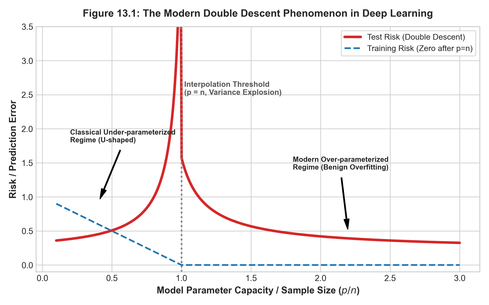

# 現代前沿：深度學習、分佈偏移與可解釋性 {#sec-ch13}

## 本章導讀

在完成了從線性迴歸、正則化、支援向量機、集成學習到非監督降維與分群的完整巡禮後，我們來到了統計學習的最前沿。

在二十一世紀第三個十年，資料科學與人工智慧正面臨三大革命性的範式轉移（Paradigm Shifts）：
1. **「雙重下降（Double Descent）」現象**：現代深層神經網路與過度參數化模型（參數量遠大於樣本數），顛覆了古典統計學百年來奉為圭臬的「U 型偏誤-變異數權衡」認知。
2. **「分佈偏移（Distribution Shift）」的現實挑戰**：真實世界並非恆定不變的閉合系統，訓練資料與線上真實環境往往違背獨立同分佈（I.I.D.）假設。
3. **「高維多重檢定」與「可解釋性 AI（XAI）」**：從萬維基因體與巨量特徵中，如何控制偽發現率（FDR）？面對複雜的黑盒子集成模型，如何利用賽局理論（Shapley Values）給出具備公理保證的歸因解釋？

本章將帶領讀者透視這些前沿課題的底層數學本質，完成全書知識體系的終極昇華。

---

## 13.1 深度學習的統計謎題：雙重下降現象（Double Descent）

### 13.1.1 傳統統計觀點 vs 現代深度學習實踐

在第 2 章中，我們嚴格證明了古典的**偏誤-變異數權衡定理**：
隨著模型容量（Capacity / Parameters）的增長，偏誤單調下降，但估計變異數單調暴增，導致全域泛化誤差呈現一條先降後升的經典 **U 型曲線（U-shaped Curve）**。

然而，現代深層大型語言模型（如 GPT 系列）與巨型卷積網路（ResNet）的參數量往往是訓練樣本量的數十倍甚至數萬倍（$p \gg n$）。按照傳統統計理論，這些模型應當產生毀滅性的過度配適。但令人震驚的是：**在過度參數化（Overparameterization）且訓練誤差達到 0 的情況下，模型的測試誤差往往不升反降，甚至取得歷史最優的泛化表現！**

### 13.1.2 雙重下降曲線機制（Belkin et al. 2019）

Mikhail Belkin、Daniel Hsu 等學者於 2019 年在《PNAS》發表里程碑論文，將古典統計與現代機器學習調和在一張統一的曲線中——**雙重下降曲線（Double Descent Curve）**，如 @fig-ch13-double-descent 所示：

{#fig-ch13-double-descent width=85%}

#### 數學機理剖析：
1. **古典區間（Under-parameterized, $p < n$）**：
   模型無法完美插值所有訓練點。隨著 $p$ 增加，偏誤減小，方差增大，在 $p$ 接近 $n$ 之前表現為標準的 U 型曲線。
2. **插值臨界點（Interpolation Boundary, $p = n$）**：
   當模型的有效容量恰好能夠完全穿過（插值）所有訓練資料點時，設計矩陣 $\boldsymbol{X}^\top \boldsymbol{X}$ 的最小奇異值趨近於零（$\lambda_{\min} \to 0$），估計量的方差達到極值發散，測試誤差暴增至頂峰。
3. **過度參數化區間（Over-parameterized, $p > n$）**：
   此時存在無窮多個能夠達到訓練誤差為 0 的插值解。現代梯度下降演算法（SGD）隱式地選擇了**具有最小範數（Minimum-norm solution）**的最光滑插值解：
   $$
   \hat{\boldsymbol{\beta}} = \arg\min_{\boldsymbol{\beta}} \|\boldsymbol{\beta}\|_2 \quad \text{s.t.} \quad \boldsymbol{X}\boldsymbol{\beta} = \boldsymbol{y}
   $$ {#eq-ch13-double-descent}
   隨著參數空間維度 $p$ 繼續暴增，超平面的可行解空間急遽膨脹，隱式正則化作用愈發強大，模型的有效曲率反而變得更加平緩，驅使測試誤差展開**第二重單調下降**！這在統計學上被稱為**良性過度配適（Benign Overfitting）**。

---

## 13.2 非平穩學習與共變量偏移（Covariate Shift）

經典機器學習的基石是 **I.I.D. 假設**（訓練集與測試集獨立同分佈於同一個聯合分佈 $\mathcal{P}(\boldsymbol{X}, Y)$）。
但在現實世界中，分佈發生動態漂移。

### 13.2.1 共變量偏移定義（Sugiyama 2015）

**共變量偏移（Covariate Shift）**是指：
1. 輸入特徵的邊際機率分佈發生改變：
   $$
   P_{\text{train}}(\boldsymbol{X}) \neq P_{\text{test}}(\boldsymbol{X})
   $$
2. 給定特徵下目標變數的條件機率分佈保持不變：
   $$
   P_{\text{train}}(Y \mid \boldsymbol{X}) = P_{\text{test}}(Y \mid \boldsymbol{X})
   $$

### 13.2.2 重要性加權（Importance Weighting）推導

我們期望最小化測試集上的真實風險：
$$
R_{\text{test}}(f) = \mathbb{E}_{(\boldsymbol{X}, Y) \sim P_{\text{test}}}[L(Y, f(\boldsymbol{X}))] = \int L(y, f(\boldsymbol{x})) P_{\text{test}}(\boldsymbol{x}, y) d\boldsymbol{x} dy
$$

由條件機率公式 $P(\boldsymbol{x}, y) = P(y \mid \boldsymbol{x})P(\boldsymbol{x})$，並利用共變量偏移假設 $P_{\text{test}}(y \mid \boldsymbol{x}) = P_{\text{train}}(y \mid \boldsymbol{x})$：
$$
\begin{aligned}
R_{\text{test}}(f) &= \int L(y, f(\boldsymbol{x})) P_{\text{train}}(y \mid \boldsymbol{x}) P_{\text{test}}(\boldsymbol{x}) d\boldsymbol{x} dy \\
&= \int L(y, f(\boldsymbol{x})) P_{\text{train}}(y \mid \boldsymbol{x}) P_{\text{train}}(\boldsymbol{x}) \cdot \underbrace{\left( \frac{P_{\text{test}}(\boldsymbol{x})}{P_{\text{train}}(\boldsymbol{x})} \right)}_{w(\boldsymbol{x})} d\boldsymbol{x} dy \\
&= \mathbb{E}_{(\boldsymbol{X}, Y) \sim P_{\text{train}}}\left[ w(\boldsymbol{X}) L(Y, f(\boldsymbol{X})) \right]
\end{aligned}
$$ {#eq-ch13-importance-weighting}

其中 $w(\boldsymbol{x}) \triangleq \frac{P_{\text{test}}(\boldsymbol{x})}{P_{\text{train}}(\boldsymbol{x})}$ 稱為**重要性權重（Importance Weight）**或**密度比（Density Ratio）**。只需在訓練時對每個訓練樣本點乘以其重要性權重 $w(\boldsymbol{x}_i)$ 進行加權經驗風險最小化即可消除偏移影響。

---

## 13.3 大數據時代的多重假設檢定與 FDR 控制

在現代大數據環境中，我們經常面對數萬個特徵的同步假設檢定。

### 13.3.1 多重檢定的「偽陽性爆炸」與 Bonferroni 缺陷
若對 $m = 1000$ 個檢定均採用標準顯著水準 $\alpha = 0.05$：
當所有假設皆為真時，至少犯下一次型一誤差的家族累積錯誤率為：
$$
\mathrm{FWER} = 1 - (1 - \alpha)^m \approx 1 - (0.95)^{1000} \approx 100\%
$$
傳統 **Bonferroni 修正** 強制將單個顯著水準降為 $\alpha / m = 0.05 / 1000 = 0.00005$，極度保守，將大幅扼殺真實微弱的統計信號。

### 13.3.2 偽發現率（FDR）與 Benjamini-Hochberg (BH) 程序
Yoav Benjamini 與 Yosef Hochberg (1995) 提出了**偽發現率（False Discovery Rate, FDR）**：
$$
\mathrm{FDR} \triangleq \mathbb{E}\left[ \frac{V}{R} \;\middle|\; R > 0 \right] P(R > 0)
$$
其中 $R$ 為宣稱顯著的總發現數，$V$ 為其中誤判的偽陽性數。

#### BH 逐步檢定程序：
1. 將所有 $m$ 個檢定的 $p$-值由小到大升冪排序：$p_{(1)} \le p_{(2)} \le \dots \le p_{(m)}$。
2. 給定目標 FDR 控制水準 $q^*$（如 $q^* = 0.05$）。
3. 尋找滿足以下條件的**最大排序索引值 $k$**：
   $$
   k = \max \left\{ i \;\middle|\; p_{(i)} \le \frac{i}{m} q^* \right\}
   $$ {#eq-ch13-bh-step}
4. **拒絕所有對應於最小 $k$ 個 $p$-值的虛無假設**（判定 $H_{(1)}, \dots, H_{(k)}$ 顯著）。

---

## 13.4 手把手數值推演：BH 程序與 Shapley 值手算

### 13.4.1 BH 程序 6 假設手算示範
設有 $m=6$ 個特徵檢定，其未校正之原始 $p$-值分別為：
$$
p_1 = 0.002, \, p_2 = 0.045, \, p_3 = 0.012, \, p_4 = 0.080, \, p_5 = 0.035, \, p_6 = 0.001
$$
設定目標 FDR 水準 $q^* = 0.05$。

#### 步驟 1：升冪排序 $p$-值並計算臨界閾值 $\frac{i}{m} q^*$

| 排序 $i$ | 原假設 | 排序後 $p_{(i)}$ | 臨界閾值 $\frac{i}{6} \times 0.05$ | 檢驗不等式 $p_{(i)} \le \frac{i}{m} q^*$ | 判定 |
| :---: | :---: | :---: | :---: | :---: | :---: |
| 1 | $H_6$ | $0.0010$ | $0.00833$ | $0.0010 \le 0.00833$ (成立) | 滿足 |
| 2 | $H_1$ | $0.0020$ | $0.01667$ | $0.0020 \le 0.01667$ (成立) | 滿足 |
| **3** | **$H_3$** | **$0.0120$** | **$0.02500$** | **$0.0120 \le 0.02500$ (成立)** | **滿足 (最大點 $k=3$)** |
| 4 | $H_5$ | $0.0350$ | $0.03333$ | $0.0350 > 0.03333$ (不成立) | 不滿足 |
| 5 | $H_2$ | $0.0450$ | $0.04167$ | $0.0450 > 0.04167$ (不成立) | 不滿足 |
| 6 | $H_4$ | $0.0800$ | $0.05000$ | $0.0800 > 0.05000$ (不成立) | 不滿足 |

#### 步驟 2：確定決策臨界點
滿足條件的最大排序索引為 $k = 3$！
因此，**拒絕 $H_{(1)}, H_{(2)}, H_{(3)}$（即 $H_6, H_1, H_3$）**，判定這三個特徵為統計顯著；其餘 $H_5, H_2, H_4$ 視為不顯著。

> 💡 **方法對比洞見**：
> 1. **未校正標準（$\alpha = 0.05$）**：會誤將 $H_5 (0.035)$ 與 $H_2 (0.045)$ 判定為顯著，引入大量偽發現。
> 2. **Bonferroni 修正（$\alpha/6 = 0.00833$）**：僅能拒絕 $H_6$ 與 $H_1$，導致真實有效信號 $H_3 (0.012)$ 被錯誤扼殺。
> 3. **BH 程序**：成功保留了 $H_3$，同時精準剔除了 $H_5$ 與 $H_2$，在靈敏度與特異度間取得最優平衡！

---

### 13.4.2 雙特徵 Shapley 值手算示範
設模型包含 2 個特徵 $\mathcal{F} = \{x_1, x_2\}$。
基準無特徵預測輸出（Base Rate）：$v(\emptyset) = 20$。
各特徵子集預測值如下：
* 僅包含特徵 1：$v(\{x_1\}) = 35$
* 僅包含特徵 2：$v(\{x_2\}) = 25$
* 包含兩者特徵：$v(\{x_1, x_2\}) = 50$

求各特徵之 Shapley 貢獻值 $\phi_1, \phi_2$：
特徵可能進入聯盟的排列順序共有 $2! = 2$ 種：
1. **順序一：先加入 $x_1$，後加入 $x_2$**（機率各為 $1/2$）：
   * $x_1$ 的邊際貢獻：$v(\{x_1\}) - v(\emptyset) = 35 - 20 = +15$。
   * $x_2$ 的邊際貢獻：$v(\{x_1, x_2\}) - v(\{x_1\}) = 50 - 35 = +15$。
2. **順序二：先加入 $x_2$，後加入 $x_1$**（機率各為 $1/2$）：
   * $x_2$ 的邊際貢獻：$v(\{x_2\}) - v(\emptyset) = 25 - 20 = +5$。
   * $x_1$ 的邊際貢獻：$v(\{x_1, x_2\}) - v(\{x_2\}) = 50 - 25 = +25$。

加權計算特徵 Shapley 值：
$$
\phi_1 = \frac{1}{2}(15) + \frac{1}{2}(25) = \mathbf{20}
$$
$$
\phi_2 = \frac{1}{2}(15) + \frac{1}{2}(5) = \mathbf{10}
$$

> **驗證效率性公理（Efficiency Axiom）**：
> $$
> \phi_1 + \phi_2 = 20 + 10 = 30 = 50 - 20 = v(\{x_1, x_2\}) - v(\emptyset) \quad \blacksquare
> $$
> 兩特徵的邊際歸因值之和精準等於整體預測值與基準值的差額！

---

## 13.5 可解釋性人工智慧（Explainable AI, XAI）與 SHAP

Scott Lundberg 提出的 **SHAP（SHapley Additive exPlanations）** 是基於式 ([-@eq-ch13-shapley-value]) 的現代可解釋性標準：
$$
\phi_i(v) \triangleq \sum_{S \subseteq \mathcal{F} \setminus \{i\}} \frac{|S|! \, (|\mathcal{F}| - |S| - 1)!}{|\mathcal{F}|!} \Big[ v(S \cup \{i\}) - v(S) \Big]
$$ {#eq-ch13-shapley-value}

其具備四大唯一公理保證：**效率性（Efficiency）**、**對稱性（Symmetry）**、**虛擬性（Dummy Player）** 與 **可加性（Additivity）**。

---

## 13.6 雙軌實務實驗室：FDR 多重校正與 SHAP 解釋實戰

::: {.panel-tabset}
### 🟦 R 語言雙軌實作

```r
# ==============================================================================
# R 實作：stats::p.adjust (BH 程序控制 FDR) 與大規模假設檢定
# 依賴套件：stats, ISLR2
# ==============================================================================

# 1. 模擬包含 2000 個特徵的大規模檢定情境 (其中前 50 個特徵為真實有顯著差異)
set.seed(42)
m <- 2000
m_true <- 50

# 前 50 個檢定具有真實效應 (均值不為 0)
true_pvalues <- rbeta(m_true, shape1 = 0.5, shape2 = 10)
# 後 1950 個檢定為純隨機噪聲 (服從 [0, 1] 均勻分佈)
null_pvalues <- runif(m - m_true, min = 0, max = 1)

all_pvalues <- c(true_pvalues, null_pvalues)

# 2. 未校正之原始 p-值顯著數量 (alpha = 0.05)
raw_significant <- sum(all_pvalues < 0.05)
cat(sprintf("未校正 p < 0.05 檢定出的特徵數: %d (包含大量假陽性噪聲)\n", raw_significant))

# 3. 極度保守的 Bonferroni 修正 (控制 FWER <= 0.05)
bonf_p <- p.adjust(all_pvalues, method = "bonferroni")
bonf_significant <- sum(bonf_p < 0.05)
cat(sprintf("Bonferroni 修正 (過度保守) 檢定出的特徵數: %d\n", bonf_significant))

# 4. Benjamini-Hochberg (BH) 程序控制 FDR <= 0.05
fdr_p <- p.adjust(all_pvalues, method = "BH")
fdr_significant <- sum(fdr_p < 0.05)
cat(sprintf("Benjamini-Hochberg (BH) 程序檢定出的特徵數: %d\n", fdr_significant))

# 5. 檢驗 BH 程序在真實信號上的檢出表現 (真陽性 vs 偽陽性)
detected_idx <- which(fdr_p < 0.05)
true_positives <- sum(detected_idx <= m_true)
false_positives <- sum(detected_idx > m_true)

cat(sprintf("BH 程序中真陽性數量 (True Discoveries): %d / %d\n", true_positives, m_true))
cat(sprintf("BH 程序中偽陽性數量 (False Discoveries): %d\n", false_positives))
cat(sprintf("實證偽發現率 (Empirical FDR): %.2f%%\n", (false_positives / fdr_significant) * 100))
```

### 🟨 Python 雙軌實作

```python
# ==============================================================================
# Python 實作：SHAP (Shapley Additive exPlanations) 解釋黑盒子集成模型
# 依賴套件：numpy, pandas, scikit-learn, xgboost, shap
# ==============================================================================

import numpy as np
import pandas as pd
from xgboost import XGBRegressor
import shap

# 1. 模擬具備清晰物理規律的非線性房價資料 (n=400, p=5)
np.random.seed(42)
n = 400
income = np.random.uniform(20, 100, n)
rooms = np.random.uniform(1, 8, n)
age = np.random.uniform(0, 50, n)
tax = np.random.uniform(10, 50, n)
noise = np.random.normal(0, 1, n)

# 真實非線性房價方程
price = 50 + 1.2 * income + 8.0 * rooms - 0.5 * age + 0.05 * (income * rooms) + noise

X = pd.DataFrame({'Income': income, 'Rooms': rooms, 'HouseAge': age, 'TaxRate': tax})
y = price

# 2. 擬合強大的 XGBoost 黑盒子迴歸模型
model = XGBRegressor(n_estimators=100, max_depth=3, learning_rate=0.08, random_state=42)
model.fit(X, y)

# 3. 建構 TreeExplainer 並計算全體樣本之精確 Shapley 值
explainer = shap.TreeExplainer(model)
shap_values = explainer(X)

# 4. 驗證 Efficiency 效率性公理
sample_idx = 0
sample_pred = model.predict(X.iloc[[sample_idx]])[0]
base_value = explainer.expected_value
sum_shap = np.sum(shap_values.values[sample_idx])

print("=== SHAP 效率性公理 (Efficiency Axiom) 數學驗證 ===")
print(f"基準期望預測值 (Base E[f(x)]): {base_value:.4f}")
print(f"樣本 0 之實際模型輸出 f(x): {sample_pred:.4f}")
print(f"樣本 0 之各特徵 Shapley 值總和: {sum_shap:.4f}")
print(f"驗證差值 (Base + Sum(SHAP) - f(x)): {np.abs((base_value + sum_shap) - sample_pred):.8f}")

# 5. 全域特徵平均絕對 Shapley 值
mean_abs_shap = np.mean(np.abs(shap_values.values), axis=0)
for feat_name, imp in zip(X.columns, mean_abs_shap):
    print(f"特徵 [{feat_name}] 之平均邊際貢獻度: {imp:.4f}")
```
:::

---

## 13.7 課後全方位習題庫（10 題）

### 一、觀念理解與數學證明（5 題）

1. **最小範數插值解之 Moore-Penrose 虛擬反矩陣證明**：
   在過度參數化迴歸中（$p > n$ 且 $\mathrm{rank}(\boldsymbol{X}) = n$），證明式 ([-@eq-ch13-double-descent]) 的最小 $L_2$ 範數插值解具有封閉形式：$\hat{\boldsymbol{\beta}} = \boldsymbol{X}^\top (\boldsymbol{X} \boldsymbol{X}^\top)^{-1} \boldsymbol{y}$，並說明為何梯度下降（從零初始化開始）必收斂至此解。
2. **BH 程序 FDR 上界定理嚴格證明**：
   在所有檢定統計量相互獨立的前提下，利用全期望公式證明式 ([-@eq-ch13-bh-step]) 的 BH 程序滿足：$\mathbb{E}\left[\frac{V}{R} \;\middle|\; R > 0\right] P(R > 0) = \frac{m_0}{m} q^* \le q^*$。
3. **密度比重要性加權估計量的方差分析**：
   在式 ([-@eq-ch13-importance-weighting]) 中，雖然重要性加權估計量在期望上是無偏的，但證明當測試分佈與訓練分佈相差懸殊時，$w(\boldsymbol{X}) = P_{\text{test}}(\boldsymbol{X}) / P_{\text{train}}(\boldsymbol{X})$ 的變異數會爆炸，導致經驗風險估計量高度不穩定。
4. **Shapley 值的唯一性定理證明**：
   證明符合「效率性、對稱性、虛擬性、可加性」四條公理的特徵貢獻分配方式是唯一的，且必為式 ([-@eq-ch13-shapley-value]) 的加權形式。
5. **良性過度配適的特徵值衰減條件（Bartlett et al. 2020）**：
   簡述彼得·巴特利特教授在過度參數化線性迴歸中提出的「良性過度配適」充要條件：說明為什麼共變異數矩陣的特徵值必須具備「重尾（Heavy Tail）」結構才能使插值噪聲被大量有效維度分散吸收。

### 二、程式實作與實務應用（5 題）

6. **過度參數化多項式雙重下降現象重現**：
   撰寫程式，固定樣本量 $n=40$，將多項式特徵維度 $p$ 由 1 逐步增加至 120。使用最小範數偽逆求解，繪製測試 MSE 隨 $p$ 變化的完整曲線，重現 $p=40$ 處的插值峰值與 $p > 40$ 的第二重下降。
7. **核均值匹配（Kernel Mean Matching, KMM）修正共變量偏移**：
   產生一組訓練分佈 $P_{\text{train}}(X) \sim \mathcal{N}(0, 1)$ 與測試分佈 $P_{\text{test}}(X) \sim \mathcal{N}(1.5, 1)$。實作核均值匹配（KMM）演算法透過二次規劃求解樣本權重 $\hat{w}_i$，並驗證加權迴歸在測試集上的 RMSE 改進。
8. **基因微陣列多重檢定與火山圖（Volcano Plot）繪製**：
   利用包含數千個基因的微陣列數據，對比患病組與對照組。計算每個基因的兩組獨立樣本 $t$-檢定 $p$-值與 Fold Change，使用 BH 程序校正，並繪製標準火山圖標註顯著差異表現基因。
9. **TreeSHAP 交互作用值（SHAP Interaction Values）可視化**：
   使用 Python `shap` 套件訓練包含特徵非線性交互的 XGBoost 模型，計算二階特徵交互 Shapley 矩陣，並繪製 SHAP 依賴圖（Dependence Plot）解析特徵間的調節效應。
10. **LIME vs SHAP 局部歸因一致性比較**：
    在分類模型上，挑選 5 筆邊界測試樣本，分別使用 LIME（局部可解釋模型無關解釋器）與 KernelSHAP 估計各特徵的局部重要性權重，量化評估兩者在特徵重要性符號與排序上的一致性指標。
